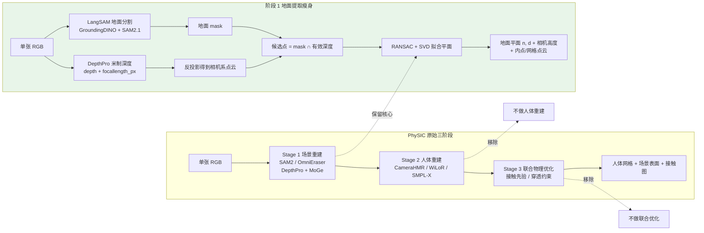
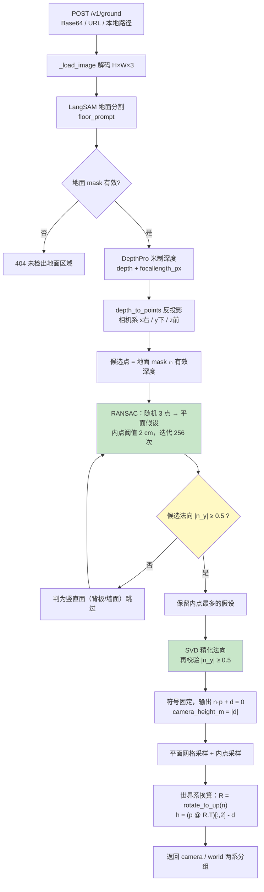
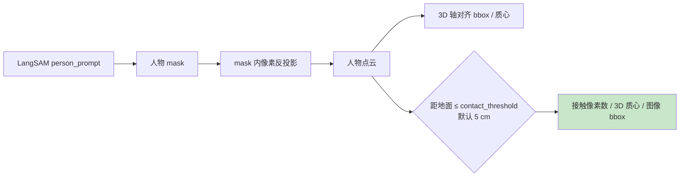
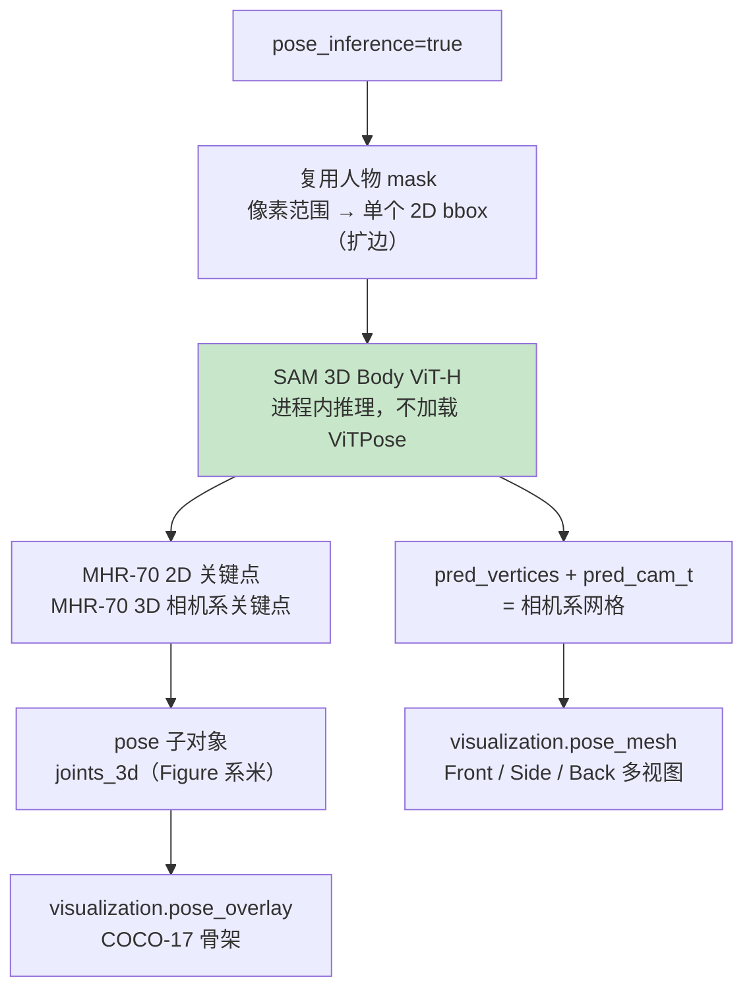
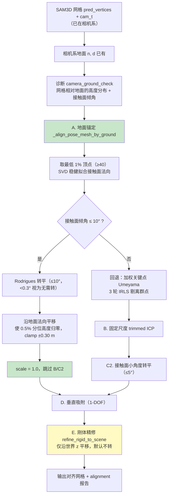
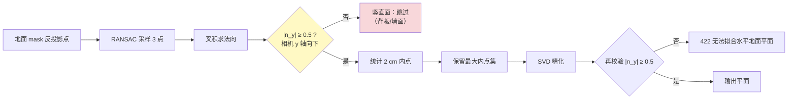
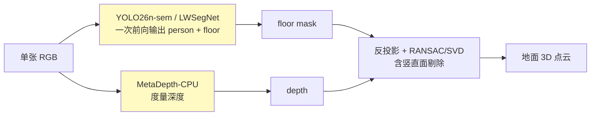
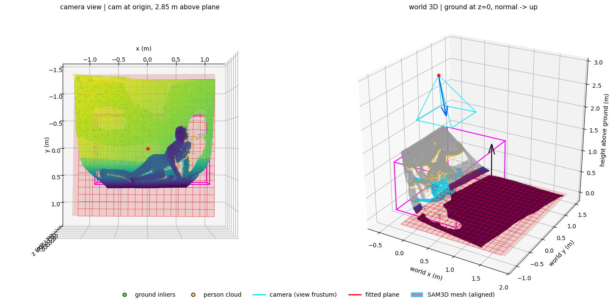
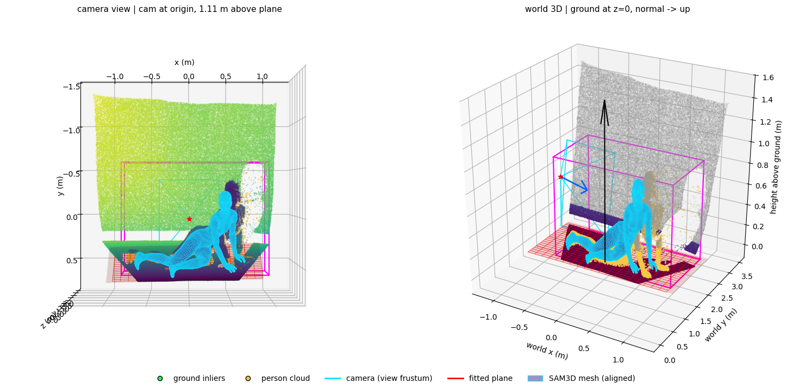

# PhySIC 瘦身方案：从单图人-场景交互重建到地面几何提取与可选姿势落地

> 文档状态：已按 `ground_pipeline` 当前代码与实测结果更新。原方案中「YOLO26n-sem / LWSegNet + MetaDepth-CPU」的轻量化替换**尚未实施**，保留为阶段 5 的规划；当前线上链路仍是 LangSAM + DepthPro。

## 一、PhySIC 与「单独姿势推理」各自解决什么问题

### 1.1 PhySIC 的意义

PhySIC 是 SIGGRAPH Asia 2025 的论文《PhySIC: Physically Plausible 3D Human-Scene Interaction and Contact from a Single Image》（arXiv 2510.11649），TL;DR 是「Human-Scene Interaction and Contact from a Single Image with Physical Plausibility」。

它针对的是单目重建里最容易被拆开处理、却又强耦合的一对问题：**人离不开场景，场景也解释人**。

- 人体重建需要场景提供尺度与支撑面，否则网格只能「悬在空中」，站、坐、卧无法判定；
- 场景理解需要人提供尺度与接触证据，否则一张图里的地面、椅子、床只能靠外观猜测；
- 物理可信要求两者一致：脚踩在地上、臀部坐在面上、身体不穿模、接触区域与几何吻合。

因此 PhySIC 的输出是三件套：**人体网格 + 场景表面（含地面）+ 人-场景接触图**，并且用联合优化把三者拉到同一套度量与接触约束下。它的价值在于：只给一张普通 RGB，就能得到可摆放、可交互、物理上说得通的人-场景数字化结果，适用于单图素材重建、AR/VR 内容、机器人与仿真场景摆放、动作与接触分析等。

代价同样明确：模型数量多（SAM2、OmniEraser、DepthPro、MoGe、CameraHMR、WiLoR、SMPL-X）、依赖 SMPL/SMPL-X 授权数据、需要多阶段联合优化，部署重、单次耗时长。

### 1.2 单独姿势推理（如 SAM3D Body）的意义

SAM3D Body 这类模型只回答一个问题：**画面里的人是什么姿势**。输入一张图或一个人体框，输出关节位置与人体网格，不需要任何场景几何。

它的价值是「轻」和「纯」：

- 单模型、进程内一次前向，不依赖 SMPL-X 拟合管线；
- 对姿态分类、动作识别、健身计数、动画驱动、人体测量等任务已经足够；
- 不关心背景，因此对场景杂乱、地面不可见的图片同样可用。

但它的输出是「悬空的人」，这正是它与 PhySIC 的差距：

- **没有地面，落位无解**：网格只有相机系下的相对位置，无法判断人站在哪、坐在什么高度、是否躺平；
- **没有世界坐标**：不能直接放进 SLAM 地图、导航栅格或机器人场景；
- **没有物理约束**：姿势对了但可能穿地或悬空，单看网格无法发现；
- **深度误差无人纠正**：单目深度在人体边缘、衣物处的系统性偏差会直接进入网格，缺少场景几何作为参照。

在旧版本里，我们用 3D 关键点做 Umeyama 对齐，结果模型把深度尺度偏差吸收成了相似变换的尺度（`scale = 0.7878`），姿势被整体缩水——这就是「只做姿势、不引入地面」的典型后果（详见 7.2）。

### 1.3 本项目的取舍

| 维度 | PhySIC 原始 | 单独 SAM3D 姿势 | 本项目 |
|---|---|---|---|
| 输入 | 单张 RGB | 单张 RGB / 人体框 | 单张 RGB |
| 人体姿势 | SMPL-X 拟合 | ✅ 关节 + 网格 | ✅ 可选 SAM3D（MHR-70） |
| 场景/地面 | 人体-场景联合重建 | ❌ 无 | ✅ 地面平面 + 点云 |
| 世界坐标 | ✅ 联合优化 | ❌ 仅相机系 | ✅ 相机系 + 世界系双份 |
| 接触/穿透 | 接触图 + 穿透约束 | ❌ 无 | 接触区 + 落地校验（不做优化） |
| 米制尺度 | 联合优化求解 | 依赖模型自身 | 地面锚定，`scale = 1.0` |
| 部署成本 | 6+ 模型、多阶段 | 1 个模型 | 3 个模型（SAM3D 可选） |

本项目面向的下游是地面几何消费方（SLAM、导航、测距、落地检测、场景重建），它们需要的是**可靠的地面平面与人的相对关系**，而不是毫米级的人体网格。因此取「地面为锚 + 可选姿势」：用 PhySIC Stage 1 的地面路径保证世界系与米制尺度，用 SAM3D 提供姿势，再用相机系地面把网格刚体落位。Stage 2 的 SMPL-X 拟合与 Stage 3 的联合物理优化整体移除，这也是「瘦身」二字的实际含义。

## 二、目标与现实定位

保留 PhySIC 单图、固定相机、可见地面场景下的核心能力，把管线从「人-场景联合重建与物理优化」压缩为「地面几何提取 + 可选人物/姿势分析」。

已实现的能力边界：

| 能力 | 状态 | 说明 |
|---|---|---|
| 地面平面参数（法向、`d`、相机高度） | ✅ 已实现 | 相机系，`n·p + d = 0`，同时给出世界系分组 |
| 地面点云 / 内点 / 平面网格采样 | ✅ 已实现 | 供 SLAM、导航、测距、落地检测使用 |
| 人物点云 bbox、质心、人-地接触区 | ✅ 已实现 | 依赖 LangSAM 的 `person_prompt` |
| SAM3D Body 姿势（可选） | ✅ 已实现 | `pose_inference=true`，单人假设 |
| SAM3D 网格落地配准 | ✅ 已实现 | 相机系地面锚定，尺度恒 1.0 |
| 完整人体-场景物理优化 / 接触图 | ❌ 不在范围 | 已随 Stage 2、Stage 3 移除 |
| 轻量化模型替换（YOLO-sem + MetaDepth） | ⏳ 规划中 | 见阶段 5 |

与原方案的关键偏差：**没有换成轻量分割/深度模型**。实测 LangSAM 的开集提示词与 DepthPro 的米制深度是当前链路可用的基础，替换会同时改变掩码质量、深度尺度与内参来源，需要单独立项验证。

## 三、PhySIC 原始流程回顾

PhySIC 的完整流程分为三个阶段：

| 阶段 | 内容 | 涉及模型 |
|---|---|---|
| Stage 1 | 场景重建 | SAM2、OmniEraser、DepthPro、MoGe |
| Stage 2 | 人体重建与对齐 | CameraHMR、WiLoR、SMPL-X |
| Stage 3 | 联合物理优化 | 置信度加权优化、接触先验、穿透约束 |

Stage 1 中已经包含地面平面拟合能力：地面掩码 → 3D 点云 → RANSAC 拟合平面 → 补充采样地面点。瘦身方案保留的正是这条路径。

## 四、改造阶段总览

| 阶段 | 改造内容 | 状态 | 主要代码 |
|---|---|---|---|
| 阶段 0 | PhySIC 原始三阶段（参考基线） | 参考 | 上游仓库 |
| 阶段 1 | 地面提取瘦身：LangSAM + DepthPro + RANSAC/SVD | ✅ 已实现 | [ground_service.py](file:///g:/UGit/Phy-SIC/ground_pipeline/ground_service.py)、[pipeline.py](file:///g:/UGit/Phy-SIC/ground_pipeline/pipeline.py) |
| 阶段 2 | 人物点云、3D bbox、人-地接触区 | ✅ 已实现 | `ground_service.py` |
| 阶段 3 | 进程内 SAM3D Body 姿势（可选，不加载 ViTPose） | ✅ 已实现 | [ground_pose.py](file:///g:/UGit/Phy-SIC/ground_pipeline/ground_pose.py) |
| 阶段 4 | SAM3D 网格落地配准：相机系地面锚定 + 1-DOF 精修 | ✅ 已实现 | `ground_service.py`、[ground_pose.py](file:///g:/UGit/Phy-SIC/ground_pipeline/ground_pose.py) |
| 阶段 4.5 | RANSAC 竖直面剔除（背景墙鲁棒性加固） | ✅ 已实现 | `pipeline.py` |
| 阶段 5 | 轻量化模型替换（YOLO-sem + MetaDepth） | ⏳ 未实施 | — |

### 4.1 阶段 0 → 阶段 1：砍掉人体与联合优化

移除项：OmniEraser 背景修复、MoGe 相对几何、尺度/平移 RANSAC 融合、CameraHMR/WiLoR/SMPL-X、Stage 3 全部优化。

### 4.2 阶段 1 实际实现：地面提取

### 4.3 阶段 2：人物与接触分析

### 4.4 阶段 3：SAM3D Body 姿势（可选）

姿势失败（模型未就绪、CUDA 异常、mask 无效）只把 `pose.status` 置为 `error`，地面结果照常返回。

### 4.5 阶段 4：SAM3D 网格落地配准

早期版本走「加权关键点 Umeyama → trimmed ICP → 接触面转平 → 垂直吸附 → 刚体精修」。实测在 5306 图上解出 `scale = 0.7878`，把网格缩到 0.79 倍并平移近 1 m，姿势走样——根因是把 DepthPro 的深度尺度偏差吸收进了相似变换。

当前实现改为**相机系地面锚定优先**：

`alignment` 报告中的 `camera_ground_check` 是判断锚定是否可信的关键：它给出原始网格相对**相机系地面**的 `min/p1/p5/p50/max` 高度与最低 1% 顶点的拟合面倾角。正常场景下 `min` 在几厘米内、倾角个位数，说明 SAM3D 本来就「站」在检测到的地面上，只需要转平 + 落位。

### 4.6 阶段 4.5：RANSAC 竖直面剔除

加入该判据前，5306 第三张测试图的 floor mask 覆盖了大面积背景墙，墙面内点多于地板，`camera_height_m` 被算成 2.85 m，导致后续网格被贴着墙摆放（见 7.4）。

### 4.7 阶段 5：轻量化替换（规划，未实施）

未实施原因：替换会同时改变掩码完整性、深度尺度与内参来源（轻量深度模型通常不直接给 `focallength_px`），需先用 GeoCalib 之类的单图标定补内参，再重新标定 `distance_threshold` 与 `min_vertical_component`。

## 五、当前代码结构

| 文件 | 职责 |
|---|---|
| `ground_service.py` | FastAPI 服务、模型加载、请求编排、地面/人物/姿势分析、可视化渲染、网格落地配准 |
| `ground_pose.py` | SAM3D Body ViT-H 适配器；MHR-70 关键点；`refine_rigid_to_scene` 1-DOF 精修 |
| `pipeline.py` | 纯算法核心：`depth_to_points` 反投影、`extract_ground` RANSAC + SVD + 竖直面剔除 |
| `run_ground_pipeline.sh` / `.bat` | 启动脚本（激活 `.venv-ground`、离线 HF 缓存、SAM3D 资源） |
| `GROUND_SERVICE_API.md` | 上游对接契约（字段、示例、错误码） |
| `验收失败记录_SAM3D姿势优化.md` | 姿势配准的失败记录与锚定方案实测 |

## 六、替换对照表（原始方案 vs 当前实现）

| PhySIC 环节 | 原瘦身方案 | 当前实现 | 差异说明 |
|---|---|---|---|
| SAM2 分割人体/地面 | YOLO26n-sem / LWSegNet | **LangSAM**（GroundingDINO + SAM2.1 Hiera Small） | 保留开集提示词能力；轻量模型为闭集类别，尚未验证覆盖度 |
| OmniEraser 背景修复 | 移除 | 移除 | 一致 |
| DepthPro + MoGe 双模型 | MetaDepth-CPU | **DepthPro 单模型** | 少一个融合环节，但仍非 2–4M 级轻量模型 |
| 尺度/平移 RANSAC 融合 | 移除 | 移除 | 一致 |
| RANSAC 拟合地面平面 | 保留 | 保留 + **竖直面剔除** | 实际场景背景墙占比高，必须加固 |
| 补充采样地面点 | 移除 | 移除（保留内点与网格采样） | 一致 |
| Stage 2 人体重建 | 移除 | 移除；改为**可选 SAM3D Body 姿势** | 提供关节与网格，但不做 SMPL-X 拟合 |
| Stage 3 联合物理优化 | 移除 | 移除；仅保留网格落地 1-DOF 精修 | 不输出接触图与穿透约束 |
| 输出 | 地面 3D 点云 | 地面平面 + 点云 + 人物/接触 + 可选姿势/网格 | 比原方案多一些高价值附加信息 |

## 七、实测效果

测试环境：WSL2 Ubuntu 22.04、`.venv-ground`、RTX 3090 级显卡；单次请求 10–30 s，冷启动约 2 min。

### 7.1 地面提取（阶段 1 + 2）

绿 = 地面 mask，蓝 = RANSAC 平面内点，黄 = 人物 mask，红 = 人-地接触区。图中地面 mask 与内点基本重合，接触区落在臀部与脚部着地位置。

左：相机系视角，相机位于光心、距地面 0.91 m；右：世界系，地面 `z=0`、法向朝上（黑色箭头），红色线框为拟合平面，品红为人物 bbox，青色为相机视锥。

### 7.2 网格落地配准：旧 Umeyama vs 新地面锚定

同一张图（5306，仰卧抬腿）两种配准结果对比：

| 指标 | 旧：加权关键点 Umeyama | 新：相机系地面锚定 |
|---|---|---|
| `method` | `weighted_keypoint_umeyama+depthpro` | `camera_ground_anchor` |
| `scale` | **0.7878** | **1.0** |
| `rmse_m` | 0.2642 | **0.0956** |
| `rmse_final_m` | 0.3055 | **0.0840** |
| `refine.losses.chamfer_m2` | 0.00663 | **0.00236** |
| 姿态变化 | 网格整体缩水 21%，姿势走样 | 姿势冻结，只做整体刚体搬动 |

旧结果（网格明显偏小、与点云错位）：

新结果（比例正常、贴合地面）：

### 7.3 泛化：yoga 坐姿

锚定同样生效（`scale = 1.0`、`tilt 1.79°`、`lift +2.5 cm`、接触 −1.76 cm）：

该图 3D 关键点 RMSE 为 0.3459，但 2D 重投影误差仅约 3 cm，说明差异来自 DepthPro 的深度尺度偏差，而非姿势或配准错误——这正是旧 Umeyama 会把 `s` 拉到 0.81 的同一原因。

### 7.4 竖直面剔除前后

测试图 `5306c1d3gy1hsktgsz459j20sg0ugmyv.jpg`（跪趴拿球棒），floor mask 覆盖大面积背景墙。

剔除前（`plane_normal ≈ [0.10, 0.09, 0.99]`，相机高度 2.85 m，平面立起来，网格悬空）：

剔除后（`plane_normal ≈ [0.02, 0.96, 0.30]`，相机高度 1.11 m，网格落地）：

| 指标 | 剔除前 | 剔除后 |
|---|---|---|
| `camera_height_m` | 2.85 m | **1.11 m** |
| `ground_anchor.tilt_deg` / `shift_m` | 8.94° / −0.300（clamp 打满） | 2.37° / −0.0673 |
| 接触高度 before → after | 0.7315 → 0.3997 m | 0.0690 → **0** m |
| `lowest_after_m` | +0.370 m（悬空） | **−0.0039 m** |
| `ground_snap` | applied、−0.300、`limited=true` | skipped（仅 0.39 cm） |
| `rmse_m → rmse_final_m` | 0.1867 → 0.4845（恶化） | **0.2071 → 0.2117** |
| `chamfer_m2` | 0.0377 | 0.0279 |

回归：另两张图加剔除后结果不变（RMSE 0.0956 / 0.3459，tilt 3.47° / 1.79°，shift +8.99 / +2.50 cm）。

## 八、资源与性能

| 维度 | PhySIC 原始 | 当前实现 | 原瘦身目标 |
|---|---|---|---|
| 模型数量 | 6+ | 3（LangSAM、DepthPro、可选 SAM3D） | 2 |
| 参数量级 | 数十 M 至数百 M | DepthPro + SAM2.1 Small + SAM3D ViT-H | 2–4 M |
| 冷启动 | — | 约 2 min | — |
| 单次请求 | 端到端 <27 s | 10–30 s（长边 ≤2048） | <1 s |
| 显存 | — | 与 qwen3-vl 同机约 7.8 GB | — |
| 输出 | 人体网格 + 场景表面 + 接触图 | 地面平面/点云 + 人物 bbox/接触 + 可选姿势 | 地面 3D 点云 |

## 九、注意事项

1. **加载顺序是硬约束**：必须先加载 DepthPro 再加载 LangSAM，否则 GroundingDINO 前向传播会导致 WSL VM 崩溃。SAM3D 为可选模块，未配置 `SAM3D_RESOURCES` 时姿势能力禁用，不影响地面服务。
2. **竖直面剔除阈值**：`min_vertical_component = 0.5` 允许约 60° 俯仰。俯拍/仰拍剧烈的图片若误触 422，需要临时放宽该值；反之若掩码仍混入倾斜墙面，可提高阈值。
3. **不要用关键点 Umeyama 的尺度去纠 DepthPro**：`0.79` 的缩放正是姿势走样的根因。地面锚定路径尺度恒 1.0，关键点残差仅作诊断。
4. **E 段精修是权衡项**：5306 上把接触从 −0.26 cm 推到 −2.94 cm（穿透 4.95%）换取 Chamfer 改善；跪趴图则抬高 2.95 cm（接触 +2.93 cm，轻微浮空）。若下游对穿地/浮空敏感，应收紧 `max_vertex_shift_m` 或关闭 E 段。
5. **单人假设**：人物 mask 只生成一个 2D bbox，多人场景不承诺实例级分离。
6. **平坦地面假设**：RANSAC 找不到共识时返回 422；台阶、坡道、镜面地板需要额外处理。
7. **内参来源**：`focal_px` 来自 DepthPro 的默认 FOV 估计，不是实测标定；对测距精度要求高的场景建议先做单图标定。
8. **深度尺度偏差**：DepthPro 在人体边缘、毛发、衣物处存在系统性误差，这是 3D 关键点 RMSE 偏大的主要原因，不代表地面平面错误。

## 十、一句话总结

**当前实现用「LangSAM 地面/人物分割 + DepthPro 米制深度 + RANSAC/SVD 平面拟合（含竖直面剔除）」完成地面提取，并在其上叠加可选 SAM3D 姿势与相机系地面锚定的网格落地；相比 PhySIC 的完整三阶段，砍掉了人体重建与联合物理优化，输出从「人体网格 + 场景表面 + 接触图」简化为「地面平面/点云 + 人物接触 + 可选姿势」。原方案的 YOLO-sem + MetaDepth 轻量化替换尚未落地，列为阶段 5。**
