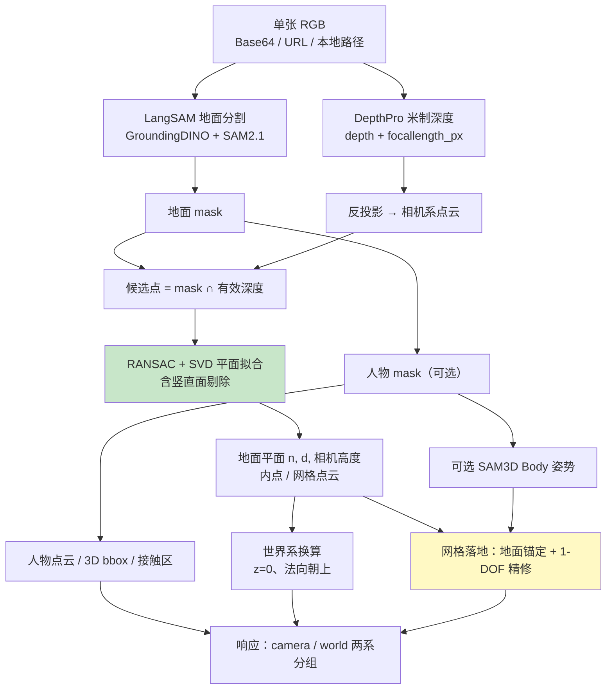
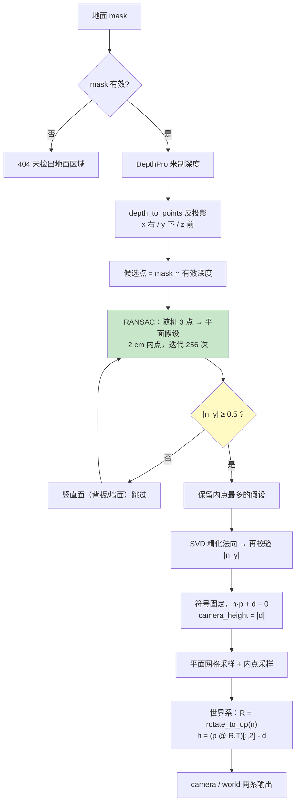
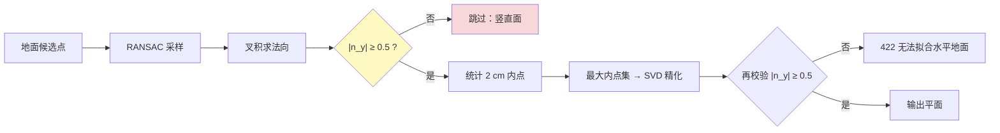
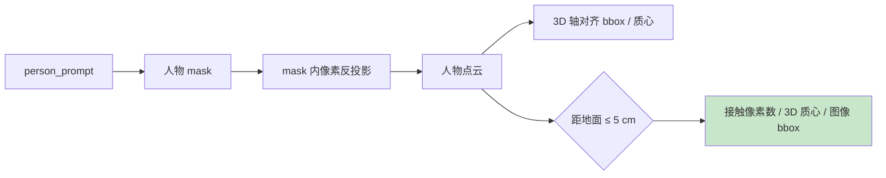
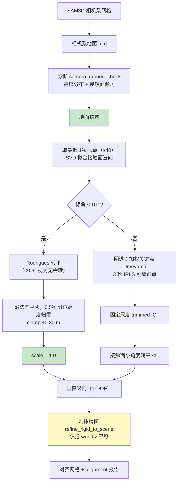
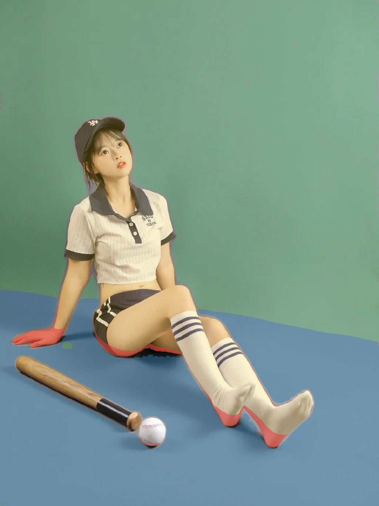
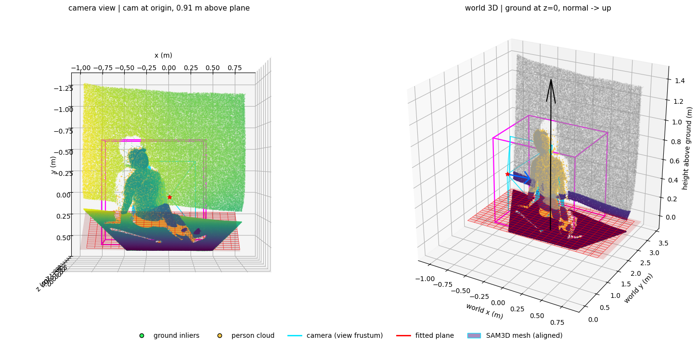
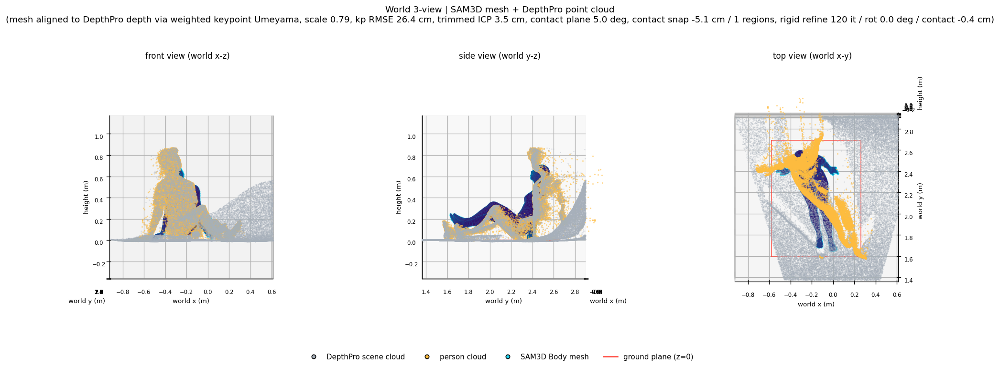
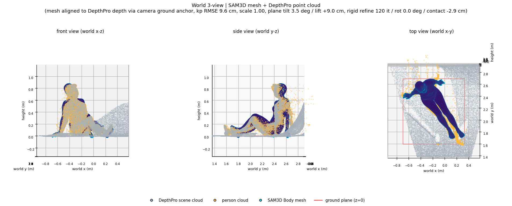
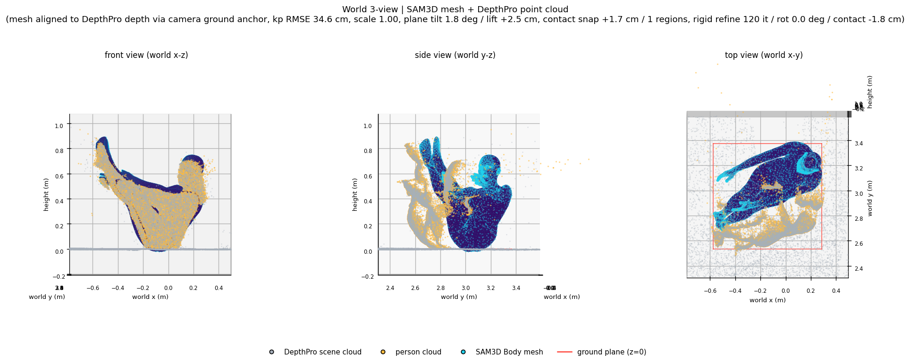

# ground_pipeline 方案线路

> 输入一张 RGB 图，输出**地面平面（法向、`d`、相机高度）+ 地面点云**，并可叠加**人物/接触分析**与**可选人体姿势 + 网格落地**。
> 面向 SLAM、导航、测距、落地检测、场景重建等几何消费方，不做人-场景联合物理优化。

## 一、定位

一条单图、固定相机、可见地面场景下的几何提取链路。核心取舍：

| 决策 | 做法 | 原因 |
|---|---|---|
| 尺度来源 | 地面锚定，网格落地 `scale = 1.0` | 单目深度的尺度偏差不应被相似变换吸收成「人缩小」 |
| 场景理解 | 开集提示词分割（`floor` / `person`） | 地面与人物共用一套分割模型，类别可换词 |
| 深度来源 | 单模型米制深度 + 自带焦距 | 少一层融合，直接给出米制点云 |
| 人体 | 只做可选姿势，不做参数化拟合 | 下游要的是落位与相对关系，不是毫米级人体网格 |
| 物理 | 只做落地校验与 1-DOF 精修 | 不做接触图与穿透优化 |

能力边界：

| 能力 | 状态 |
|---|---|
| 地面平面参数（相机系 + 世界系） | ✅ |
| 地面点云 / 内点 / 平面网格采样 | ✅ |
| 人物 3D bbox、质心、人-地接触区 | ✅ |
| 可选人体姿势（单人） | ✅ |
| 姿势网格落地配准 | ✅ |
| 接触图 / 穿透约束优化 | ❌ 不在范围 |
| 轻量分割/深度模型替换 | ⏳ 规划 |

### 使用模型

| 模型 | 组成 | 作用 | 是否必需 | 说明 |
|---|---|---|---|---|
| **LangSAM** | GroundingDINO（开集文本检测） + SAM 2.1 Hiera Small（mask 生成） | 按文本提示词分割地面 / 人物区域 | ✅ 必需 | 支持 `floor`、`person` 等任意提示词，不绑定固定类别；同一模型服务地面与人物两条分支 |
| **DepthPro** | 单目度量深度模型 | 输出米制 `depth` 与像素焦距 `focallength_px` | ✅ 必需 | 提供尺度与内参，是反投影与「相机高度」的唯一来源；必须在 LangSAM 之前加载 |
| **SAM 3D Body ViT-H** | 人体姿势估计（MHR-70 关键点 + 网格） | 输出 2D/3D 关键点与相机系网格 | ⏳ 可选 | 由 `pose_inference=true` 触发；未配置 `SAM3D_RESOURCES` 时自动禁用；单人假设，不加载 ViTPose |
| **ViTPose** | 2D 人体检测 / 关键点模型 | 人体框检测、2D 关键点与置信度 | ❌ 未接入 | 当前链路不需要：2D bbox 直接取人物 mask 的像素范围（扩边），2D 关键点由 SAM3D 原生 MHR-70 输出。代码只引用了 `ai_vitpose.core.normalize` 的骨架定义与坐标换算工具函数，不加载 ViTPose 权重；多人检测、bbox 优化与关键点置信度留待后续评估 |

模型加载与调度：

- 实际常驻的是 **DepthPro + LangSAM +（可选）SAM 3D Body ViT-H**，ViTPose 不参与加载与推理。
- 三个模型均在服务启动时由 `lifespan` 初始化，常驻复用，单次请求不再加载。
- 加载顺序是硬约束：**DepthPro → LangSAM → 可选 SAM3D**。
- SAM3D 使用 CPU offload 在请求间卸载权重，推理时仍占 GPU 显存。
- 地面链路的可用性不依赖 SAM3D：姿势模块缺失或异常只影响 `pose` 子对象。

## 二、总体链路

## 三、各阶段实现

### 3.1 地面提取

要点：

- **反投影**：`x = (u-cx)·z/fx`、`y = (v-cy)·z/fy`、`z = depth`；`fx = fy = focallength_px`，主点取图像中心。
- **平面拟合**：RANSAC 出最优内点集，SVD 最小奇异向量作为法向，`d = -n·center`。
- **世界系**：把法向转到 `+z`（朝上），地面落到 `z=0`，非地面点高度为正。

### 3.2 竖直面剔除

相机系 `y` 轴向下，真实地面法向的 `|n_y|` 接近 1，墙面/背板接近 0。RANSAC 只接受 `|n_y| ≥ 0.5` 的假设（允许约 60° 俯仰），SVD 精化后再校验一次，挡住「内点混合把法向拉回墙面」。

### 3.3 人物与接触

单人假设：只生成一个 2D bbox，多人场景不做实例分离。

### 3.4 可选姿势推理

`pose_inference=true` 时复用人物 mask，取像素范围扩边成单个 2D bbox，进程内跑 SAM 3D Body ViT-H，输出 MHR-70 的 2D/3D 关键点与相机系网格（`pred_vertices + pred_cam_t`）。姿势失败（模型未就绪、CUDA 异常、mask 无效）只把 `pose.status` 置为 `error`，地面结果照常返回。

### 3.5 网格落地配准

早期走「加权关键点 Umeyama → trimmed ICP → 转平 → 吸附 → 精修」，实测解出 `scale = 0.7878`，网格缩到 0.79 倍并平移近 1 m，姿势走样——根因是把深度尺度偏差吸收进了相似变换。

当前改为**相机系地面锚定优先**：

`alignment.camera_ground_check` 是判断锚定是否可信的关键：它给出原始网格相对**相机系地面**的 `min/p1/p5/p50/max` 高度与最低 1% 顶点的拟合面倾角。正常场景 `min` 在几厘米内、倾角个位数，说明模型本来就「站」在检测到的地面上，只需转平 + 落位。

## 四、实测效果

环境：WSL2 Ubuntu 22.04、RTX 3090 级显卡；单次请求 10–30 s，冷启动约 2 min。

### 4.1 地面提取

绿 = 地面 mask，蓝 = RANSAC 内点，黄 = 人物 mask，红 = 接触区。mask 与内点基本重合，接触区落在臀部与脚部着地点。

左：相机系，距地 0.91 m；右：世界系，地面 `z=0`，红框为拟合平面，品红为人物 bbox，青色为相机视锥。

### 4.2 落地配准：旧 Umeyama vs 地面锚定

同一张图（5306，仰卧抬腿）：

| 指标 | 旧：加权关键点 Umeyama | 新：地面锚定 |
|---|---|---|
| `method` | `weighted_keypoint_umeyama+depthpro` | `camera_ground_anchor` |
| `scale` | **0.7878** | **1.0** |
| `rmse_m` | 0.2642 | **0.0956** |
| `rmse_final_m` | 0.3055 | **0.0840** |
| `refine.losses.chamfer_m2` | 0.00663 | **0.00236** |
| 姿态变化 | 缩水 21%，姿势走样 | 冻结，只做刚体搬动 |

yoga 坐姿同样生效（`scale = 1.0`、`tilt 1.79°`、`lift +2.5 cm`、接触 −1.76 cm）：

该图 3D 关键点 RMSE 0.3459，但 2D 重投影误差仅约 3 cm，差异来自深度尺度偏差，不是姿势或配准错误。

### 4.3 竖直面剔除前后

测试图 `5306c1d3gy1hsktgsz459j20sg0ugmyv.jpg`（跪趴拿球棒），floor mask 覆盖大面积背景墙。

剔除前 `plane_normal ≈ [0.10, 0.09, 0.99]`、相机高度 2.85 m、网格悬空；剔除后 `plane_normal ≈ [0.02, 0.96, 0.30]`、相机高度 1.11 m、网格落地。

| 指标 | 剔除前 | 剔除后 |
|---|---|---|
| `camera_height_m` | 2.85 m | **1.11 m** |
| `tilt_deg` / `shift_m` | 8.94° / −0.300（clamp 打满） | 2.37° / −0.0673 |
| 接触高度 before → after | 0.7315 → 0.3997 m | 0.0690 → **0** m |
| `lowest_after_m` | +0.370 m（悬空） | **−0.0039 m** |
| `ground_snap` | applied、`limited=true` | skipped（仅 0.39 cm） |
| `rmse_m → rmse_final_m` | 0.1867 → 0.4845（恶化） | **0.2071 → 0.2117** |
| `chamfer_m2` | 0.0377 | 0.0279 |

回归：另两张图加剔除后结果不变（RMSE 0.0956 / 0.3459，tilt 3.47° / 1.79°，shift +8.99 / +2.50 cm）。

## 五、资源与性能

| 维度 | 当前实现 | 目标 |
|---|---|---|
| 模型数量 | 3（分割 + 深度 + 可选姿势） | 2 |
| 单次请求 | 10–30 s（长边 ≤2048） | <1 s |
| 冷启动 | 约 2 min | — |
| 显存 | 与 qwen3-vl 同机约 7.8 GB | — |

轻量化替换（闭集分割 + 轻量度量深度）已在阶段规划中，未实施：替换会同时改变掩码完整性、深度尺度与内参来源（轻量深度模型通常不给 `focallength_px`），需要先补单图标定，再重新标定 `distance_threshold` 与 `min_vertical_component`。

## 六、注意事项

1. **加载顺序是硬约束**：先 DepthPro 再 LangSAM，否则 GroundingDINO 前向会让 WSL VM 崩溃。姿势模型可选，未配置资源时自动禁用。
2. **竖直面阈值**：`min_vertical_component = 0.5` 允许约 60° 俯仰；剧烈俯拍/仰拍误触 422 时临时放宽，掩码混入倾斜墙面时提高。
3. **不要用关键点 Umeyama 的尺度去纠深度**：`0.79` 的缩放正是姿势走样的根因；锚定路径尺度恒 1.0，关键点残差只作诊断。
4. **E 段精修是权衡项**：5306 上把接触从 −0.26 cm 推到 −2.94 cm（穿透 4.95%）换取 Chamfer 改善；跪趴图则抬高 2.95 cm。对穿地/浮空敏感就收紧 `max_vertex_shift_m` 或关闭 E 段。
5. **单人假设**：只生成一个 2D bbox，多人不做实例分离。
6. **平坦地面假设**：RANSAC 找不到共识返回 422；台阶、坡道、镜面地板需额外处理。
7. **内参来源**：`focal_px` 来自深度模型的默认 FOV 估计，不是实测标定；高精度测距建议先做单图标定。
8. **深度尺度偏差**：人体边缘、毛发、衣物处存在系统性误差，这是 3D 关键点 RMSE 偏大的主因，不代表地面平面错误。
