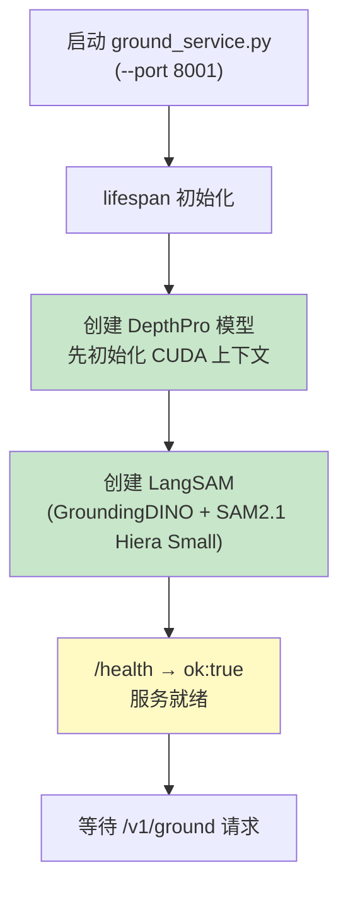
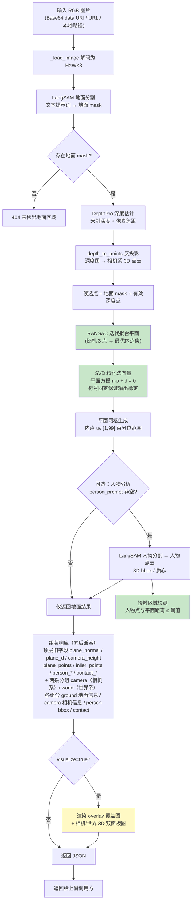
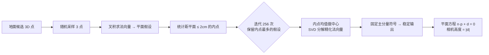

# ground_pipeline 地面提取服务 项目介绍

> 输入一张 RGB 图片，输出**地面平面参数**（法向量、平面方程、相机高度）与**平面/内点/人物 3D 点云采样**，供 SLAM、导航、测距、落地检测、场景重建等下游任务使用。

- 服务类型：单机推理 HTTP 服务（FastAPI）
- 核心能力：地面语义分割 + 单目深度估计 + 平面拟合 + 人物/接触 3D 分析 + 3D 可视化
- 运行环境：WSL2（Ubuntu 22.04）· Python 3.10 · CUDA 推理 · 端口 `8001`

---

## 1. 技术栈

| 组件 | 选型 | 职责 |
|---|---|---|
| Web 框架 | FastAPI + Uvicorn | HTTP 服务、参数校验、Swagger 文档（`/docs`） |
| 地面分割 | **LangSAM** = GroundingDINO（开集文本检测） + SAM 2.1 Hiera Small（mask 生成） | 根据提示词（如 `floor, wooden floor.`）分割出地面区域 |
| 深度估计 | **DepthPro** | 单目相对/米制深度，输出米制 `depth` + 像素焦距 `focallength_px` |
| 平面拟合 | 自研 RANSAC + SVD（`pipeline.py`） | 从地面候选点中拟合最优平面并精化法向量 |
| 可视化 | Matplotlib 3D + PIL | 覆盖图 + 相机/世界双面板 3D 渲染图 |

模型一次启动加载、常驻显存，按请求复用（合计显存约 7.8GB，含 qwen3-vl embedding 服务同机验证可用）。

---

## 2. 系统架构

```
                  ┌────────────────────────────────────────────┐
                  │            ground_pipeline                 │
   RGB 图片 ────▶ │  ground_service.py (FastAPI, port 8001)    │
 (URL/Base64/路径)│  ├─ lifespan: 加载 DepthPro → LangSAM      │──▶ 平面参数 / 点云 / 可视化
                  │  ├─ GET  /health        模型就绪检查        │
                  │  └─ POST /v1/ground     地面提取主接口       │
                  │  pipeline.py: 反投影 + RANSAC + SVD 拟合     │
                  └────────────────────────────────────────────┘
```

代码结构：

| 文件 | 职责 |
|---|---|
| `ground_service.py` | FastAPI 服务、模型加载、请求编排、可视化渲染（`_ground_views_png`/`_overlay_png`） |
| `pipeline.py` | 纯算法核心：`depth_to_points` 反投影、`extract_ground` RANSAC 平面拟合 |
| `run_ground_pipeline.sh` / `.bat` | 启动脚本（激活 `.venv-ground`、离线 HF 缓存） |
| `GROUND_SERVICE_API.md` | 上游对接文档（接口字段、调用示例、错误码） |

---

## 3. 处理流程图

### 3.1 服务启动（模型加载）



> ⚠️ 加载顺序是硬约束：**必须先加载 DepthPro 再加载 LangSAM**。若 SAM2 作为第一个 CUDA 模型加载，GroundingDINO 前向传播会导致 WSL VM 崩溃。

### 3.2 单次请求处理（`POST /v1/ground`）



### 3.3 平面拟合核心（RANSAC + SVD）



---

## 4. 核心算法说明

### 4.1 反投影（深度图 → 3D 点云）

相机坐标系约定：原点在光心，`x` 右、`y` 下、`z` 前（单位米）。

```
x = (u - cx) · z / fx
y = (v - cy) · z / fy
z = depth(u, v)
```

`DepthPro` 输出的 `focallength_px` 作为 `fx = fy`，`cx, cy` 取图像中心。

### 4.2 地面平面拟合

1. **RANSAC**：从地面分割出的候选点中随机取 3 点做平面假设，统计距离阈值 `distance_threshold=0.02m` 内的内点数，迭代 `256` 次取最优。
2. **SVD 精化**：对最优内点集去中心后做 SVD，最小奇异值对应向量即平面法向量，`plane_d = -n·center`。
3. **符号固定**：法向量主分量强制为正，保证多次运行输出稳定（注意：法向量可能指向地面也可能反向，需要朝上/朝下请结合 `plane_d` 符号归一化）。

### 4.3 接触区域检测（人物-地面接触）

人物 mask 像素反投影为 3D 点后，统计与拟合平面距离 ≤ `contact_threshold`（默认 0.05m）的点——即人物贴地部位（脚底等），输出像素数、3D 质心、图像 bbox。

### 4.4 可视化坐标变换（世界系）

渲染时用 Rodrigues 旋转把相机系点云变换到世界系（`R = rotate_to_up(normal, up=(0,0,-1))`），地面对齐到 `z=0`、法向量朝上，物体离地高度为正。

---

## 5. API 一览

| 接口 | 方法 | 说明 |
|---|---|---|
| `/health` | GET | 模型就绪检查：`{"ok": true, "device": "cuda"}` |
| `/v1/ground` | POST | 地面提取主接口（详见 `GROUND_SERVICE_API.md`） |
| `/docs` | GET | Swagger 在线调试 |

`/v1/ground` 关键参数：`image`（必填，Base64 data URI / URL / 路径）、`floor_prompt`、`person_prompt`（空串跳过人物分析）、`contact_threshold`、`distance_threshold`、`iterations`、`grid_steps`、`return_data`、`visualize`。

主要响应字段（**顶层旧字段全部保留，向后兼容**；新接入方建议使用两系分组）：

| 字段 | 说明 |
|---|---|
| `camera` | **相机系分组**：`ground`（地面信息）/ `camera`（相机内参、焦距、高度）/ `person`（人物点云 bbox、质心）/ `contact`（接触区域） |
| `world` | **世界系分组**：同样四个子对象。地面平面为 `z=0`、`z` 轴向上、法向 `≈(0,0,-1)`；`camera` 含 `position_m` / `forward`（相机世界系位姿）；`person.bbox_3d_m` 为世界系轴对齐包围盒 |
| `plane_normal` / `plane_d` | 地面平面方程（相机系，旧字段） |
| `camera_height_m` | 相机到地面高度 ≈ `abs(plane_d)` |
| `focal_px` | DepthPro 估计焦距 |
| `plane_points` / `inlier_points` | 地面网格采样 / 内点采样（相机系，米） |
| `person_bbox_3d_m` / `person_centroid_m` | 人物 3D 轴对齐包围盒 / 质心（相机系，旧字段） |
| `contact_pixels` / `contact_centroid_m` / `contact_bbox` | 人物-地面接触区域统计 |
| `masks` / `person_points` / `depth_b64` | **默认关闭返回**，仅 `return_data=true`：四张 mask PNG、人物点云采样、全量深度 `.npy` |
| `visualization` | 仅 `visualize=true`：`overlay` + `views` 两张 PNG data URI |

> 两系换算：`wpts = cam_pts @ R.T`，`wpts[:,2] -= plane_d`，其中 `R = rotate_to_up(plane_normal, (0,0,-1))`。详细字段结构见 [GROUND_SERVICE_API.md](file:///G:/UGit/Phy-SIC/ground_pipeline/GROUND_SERVICE_API.md) 的"两系分组输出"。

---

## 6. 可视化输出（`visualize=true`）

### 6.1 `overlay` — 原图覆盖图

原图叠加半透明色块：**绿**=地面 mask，**蓝**=RANSAC 平面内点，**黄**=人物 mask，**红**=接触区域。用于快速检查分割/拟合是否对准地面。

### 6.2 `views` — 3D 双面板对比图（matplotlib）

| 面板 | 视角 | 内容 |
|---|---|---|
| 左：Camera View | 相机坐标系，观察者位于光心沿光轴向前（屏幕右 `+x`、下 `+y`，与真实相机图像方向一致，近大远小） | 场景点云按深度着色（viridis）、地面内点（绿）、人物点云（黄）、**地面平面红色线框网格**、**人物 bbox 品红线框**（相机系轴对齐）、相机视锥（青色棱线 + 近平面） |
| 右：World 3D | 世界坐标系，地面 `z=0`、法向量朝上，透视投影（FOV≈121°） | 场景点云按离地高度着色（地面带 viridis 高亮、非地面灰色背景）、地面内点（绿）、人物点云（黄）、**地面平面红色线框**（范围紧贴点云地面带）、**人物 bbox 品红线框**（世界系轴对齐，方向与地面网格一致）、法向箭头（黑）、相机视锥 + 蓝色观察方向箭头 |

> 渲染图经过多轮几何/视觉迭代：网格 uv 基准对齐、地面带范围匹配点云、5→12cm 深度对齐阈值、红色线框替代淹没地面的填充色、人物 bbox 世界系轴对齐。

---

## 7. 部署与启动

```bash
# WSL 内启动（或 Windows 下双击 run_ground_pipeline.bat）
cd /mnt/g/UGit/Phy-SIC/ground_pipeline
bash run_ground_pipeline.sh
```

启动参数（改脚本或命令行传入）：`--host`（默认 `0.0.0.0`）、`--port`（默认 `8001`）、`--device`（`auto`/`cuda`/`cpu`）、`--sam-type`、`--sam-ckpt`、`--floor-prompt`。

```bash
# 简单调用
curl -X POST http://127.0.0.1:8001/v1/ground \
  -H "Content-Type: application/json" \
  -d '{"image": "/mnt/g/UGit/Phy-SIC/images/man_sofa.jpg", "visualize": true}'
```

---

## 8. 性能与注意事项

1. **冷启动慢**：模型加载约 2 分钟（DepthPro + LangSAM），务必先轮询 `/health` 到 `ok:true` 再请求。
2. **单次请求耗时**：约 10~30s（示例 600×400 图片约 15s），上游超时应设 ≥120s。
3. **超长图片**：建议上游先缩放长边 ≤2048，否则 SAM2 耗时明显上升。
4. **不要调整模型加载顺序**（DepthPro 先于 LangSAM），否则 WSL VM 崩溃。
5. **与 embedding 服务（qwen3-vl, port 8000）可同机共存**，显存合计约 7.8GB，12GB 显卡留约 4GB 余量。
6. **常见错误**：`404` 未检出地面（换提示词/图片）、`422` 地面点不足或无法拟合（深度/分割质量不足）。

---

## 9. 典型使用链路

```
嵌入/语义检索服务(qwen3-vl) ──判断画面语义/检索参考图──▶ ground_pipeline ──▶ 下游几何任务
                                                                        (SLAM / 导航 / 测距 / 落地检测)
```

人物-地面接触信息（`contact_*`）可与 3D bbox（`person_bbox_3d_m`）组合，用于"人-场景交互"类任务（站立/坐/躺检测、落脚点定位等）。
