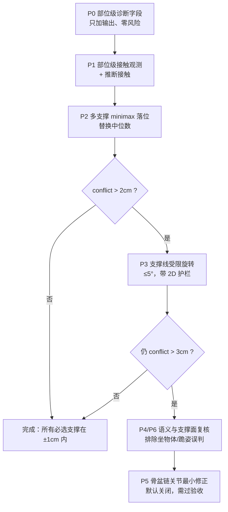

# ground_pipeline 坐姿「四肢触地、臀部悬空」问题分析与方案

- 文档性质：方案设计（不含代码改动）
- 适用范围：`ground_pipeline` 的 `/v1/ground` 姿势推理 + 网格落地链路（A→E 段）
- 触发场景：坐地、盘腿、跪坐、手撑等「躯干/骨盆也应是支撑部位」的姿势
- 不适用场景：人物坐在椅子、沙发、台阶、垫高物上——此时臀部本就不应接触地面

---

## 0. 结论摘要

这不是单点 bug，而是三层问题叠加：

1. **观测层**：接触区域只由「人物 mask 像素 + DepthPro 深度距平面 ≤ 5cm」判定，坐姿时臀部常被躯干/腿遮挡，或深度偏差超过 5cm，导致**臀部根本没有进入接触点集合**。
2. **求解层**：整条链路事实上都在优化「**全局最低的那一小撮顶点贴地**」——A 段取最低 1%、D 段取各接触簇最低点的**中位数**、E 段取最低 **60 个顶点**。坐姿时最低点通常是指尖、脚跟、手掌，于是求解器必然把四肢压到地面，臀部保持悬空。
3. **自由度层**：E 段默认只允许沿重力轴 1-DOF 平移（`max_rotation_deg=0`）。当臀部与四肢的高度差无法靠整体上下平移同时归零时，1-DOF 在数学上就**无解**，只能牺牲其中一方；当前实现牺牲的是臀部。

推荐路线：**先补观测（P1），再把「最低点贴地」改成「多支撑部位一致性」（P2），必要时用支撑线受限旋转（P3）**。P5 关节微调只作为最后兜底，且必须满足既有「姿势不得被改写」的验收约束。

---

## 1. 现象定义与边界

### 1.1 量化定义

设世界系地面为 `z=0`，人体网格顶点高度 `h(v) = (R·v)_z - plane_d`，按身体部位 `P_i` 统计：

```
gap_i = percentile_5( { h(v) | v ∈ P_i } )        # 该部位最低 5% 顶点的高度
```

判定为「四肢触地、臀部悬空」：

- `gap_hand ≤ 1cm` 或 `gap_foot ≤ 1cm`
- 且 `gap_pelvis > 2cm`

### 1.2 必须排除的误判

| 情况 | 处理 |
|---|---|
| 坐在椅子/沙发/矮凳上 | 臀部接触的是「支撑面」而非地面，不应下压。需先做支撑面检测（见 3.6） |
| 仰卧抬腿（5306 图） | 双脚本来就在空中，「脚离地」不是误差；同理不能强行让所有部位贴地 |
| 跪姿 | 支撑部位是膝/胫骨，不是臀部 |
| 背靠墙坐 | 背部接触墙面（竖直面），不应被地面接触项拉走 |

因此方案必须是**姿势语义驱动**的，而不是「让所有低点都贴地」。

---

## 2. 当前链路回顾：每一步是谁在决定贴地

| 阶段 | 位置 | 判定依据 | 坐姿下的失效方式 |
|---|---|---|---|
| 接触观测 | [ground_service.py:153-171](file:///g:/UGit/Phy-SIC/ground_pipeline/ground_service.py#L153-L171) `_contact_region` | `person_mask ∩ |n·p+d| ≤ 0.05m` | 臀部像素被遮挡 / 深度偏差 >5cm → 臀部不进接触集合 |
| A 地面锚定 | [ground_service.py:619-724](file:///g:/UGit/Phy-SIC/ground_pipeline/ground_service.py#L619-L724) `_align_pose_mesh_by_ground` | 最低 `max(40, 1%N)` 顶点拟合接触面；0.5% 分位高度归零 | 最低点是指尖/脚跟 → 锚定把四肢钉在地上，臀部随整体悬空 |
| B ICP | [ground_service.py:358-423](file:///g:/UGit/Phy-SIC/ground_pipeline/ground_service.py#L358-L423) `_trimmed_icp` | 只用平移，贴合可见人物点云 | 臀部被自身遮挡，点云里没有臀部表面 → 对臀部无约束 |
| C2 接触面转平 | [ground_service.py:529-616](file:///g:/UGit/Phy-SIC/ground_pipeline/ground_service.py#L529-L616) `_contact_plane_rotation` | 接触点 XY 邻域的网格低分位拟合平面，≤5° | 接触点只有手/脚 → 转动枢轴与平面都围绕四肢 |
| D 接触簇落位 | [ground_service.py:435-526](file:///g:/UGit/Phy-SIC/ground_pipeline/ground_service.py#L435-L526) `_contact_snap_offset` | 接触点做 XY 聚类，**取各簇最低点高度的中位数**作为落位量 | 中位数天然允许一半簇悬空；臀部没有簇时完全不受约束 |
| D 回退 | [ground_service.py:426-432](file:///g:/UGit/Phy-SIC/ground_pipeline/ground_service.py#L426-L432) `_ground_snap_offset` | 网格高度 1% 分位归零 | 同上，钉住全局最低点 |
| E 刚体精修 | [ground_pose.py:266-504](file:///g:/UGit/Phy-SIC/ground_pipeline/ground_pose.py#L266-L504) `refine_rigid_to_scene` | 最低 **60 个顶点**（≈0.3%）到 `contact_target` | 明确把「最低的 60 个顶点」当作接触定义 → 坐姿下就是四肢 |
| 关键点配准（回退） | [ground_service.py:320-355](file:///g:/UGit/Phy-SIC/ground_pipeline/ground_service.py#L320-L355) `_keypoints_depth_camera` | 权重 = mask 占比 / 深度离散度 | 髋部关键点常被遮挡，权重低 → Umeyama 被四肢主导 |

**一句话**：链路里没有任何一步知道「这是坐姿，骨盆是主支撑」，所有几何项都只认「最低点」。

---

## 3. 根因拆解

### 3.1 观测层：臀部接触像素缺失

- **自遮挡**：正面/斜前方视角下，坐姿臀部被大腿、躯干、衣物遮挡，人物 mask 里根本没有臀部着地像素。
- **深度偏差**：DepthPro 在衣物褶皱、接触阴影处系统性偏差可达数厘米；`contact_threshold=0.05m` 对臀部偏紧。
- **接触阴影**：LangSAM 的 person mask 常在贴地阴影处收缩，mask 底边高于真实接触边界。
- **结论**：即使把求解器改对，没有臀部的观测也无法知道它该落在哪。

### 3.2 语义层：缺少「支撑部位」概念

当前接触点是无标签的点集，XY 聚类只能分出「几团」，无法区分「骨盆 / 手 / 脚 / 膝」。因此：

- 无法表达「坐姿时骨盆是必选支撑、脚是可选支撑」；
- 无法在臀部观测缺失时用先验补一个「推断接触」；
- 无法识别「这是跪姿，臀部不该贴地」。

### 3.3 求解层：中位数落位 = 允许一半悬空

`_contact_snap_offset` 对每个接触簇求簇内最低点，再取**中位数**作为整体位移：

```
offset = -median(lowest_i)
```

设两个簇的原始高度为 `g1=0`（脚）、`g2=0.08m`（臀），则 `offset=0`，臀部保持 8cm 悬空；若 `g1=-0.02`、`g2=0.06`，`offset=+0.02`，脚压入 0、臀仍悬空 8cm。

对「所有必选支撑都应贴地」的目标，正确的一维解不是中位数，而是**极小极大（minimax）中点**：

```
offset* = -(max_i g_i + min_i g_i) / 2
残余冲突 conflict = (max_i g_i - min_i g_i) / 2
```

例如 `g1=0, g2=0.08` → `offset*=-0.04`，脚压入 4cm、臀悬空 4cm，误差对称；若不允许压入，则必须引入旋转或姿势修正（见 P3/P5）。

### 3.4 精修层：最低 60 顶点 = 四肢

`refine_rigid_to_scene` 用 `low_idx = argsort(z)[:60]` 定义接触高度，并把它拉到 `contact_target`。这是「全局最低点贴地」的最直接体现：

- 站姿/仰卧时合理；
- 坐姿时 60 个最低顶点大概率全在脚趾或手指上，臀部永远不在优化目标里；
- 通透地说，**E 段在结构上不可能修好坐姿臀部悬空**。

### 3.5 自由度层：1-DOF 的数学无解

当臀部与脚的高度差为 `Δh`，整体沿 z 平移只能同时改变两者相同的量，无法把两个 gap 同时归零。E 段默认 `max_rotation_deg=0`，等于放弃了唯一可能同时满足两个支撑的自由度。

### 3.6 场景层：支撑面可能不是地面

若人物坐在床、台阶、矮凳上，地面平面的 `z=0` 不是臀部支撑面。此时强行把臀部压到地面是**错误修正**。需要先判断：

- 髋部附近是否存在一个高于地面的水平支撑面（人物点云中髋部高度附近的水平面片）；
- 若有，则臀部接触目标是该面片，不参与地面对齐。

---

## 4. 方案总览

| 编号 | 方案 | 解决的问题 | 改动范围 | 优先级 |
|---|---|---|---|---|
| P0 | 部位级诊断字段 | 无法判断「没检测到」还是「检测到但没对齐」 | 只加输出 | 最高（先做） |
| P1 | 部位级接触观测与推断接触 | 臀部观测缺失 | 接触检测 + 部位标签 | 高 |
| P2 | 多支撑 minimax 落位 | 中位数允许一半悬空 | D 段落位 | 高（核心） |
| P3 | 支撑线受限旋转 | 1-DOF 数学无解 | C2/D 段，≤5° | 中 |
| P4 | 姿势语义 → 支撑集合 | 跪/坐/卧/手撑不分 | 新增分类器 | 中 |
| P5 | 关节最小修正（兜底） | 网格姿势本身臀部离地 | 姿势层，严格受限 | 低（默认关闭） |
| P6 | 支撑面检测 | 坐在物体上被误压 | 场景分析 | 中 |

---

## 5. 方案细节

### P0：部位级诊断字段（先做，零风险）

在响应中新增 `contact_parts` 与 `support` 两个对象（只增不改，保持向后兼容）：

```json
{
  "contact_parts": {
    "pelvis": {"pixels": 0,  "gap_m": 0.082, "visible_ratio": 0.12, "source": "inferred"},
    "l_hand": {"pixels": 143, "gap_m": 0.004, "visible_ratio": 0.91, "source": "observed"},
    "l_foot": {"pixels": 286, "gap_m": 0.001, "visible_ratio": 0.88, "source": "observed"}
  },
  "support": {
    "pose_class": "sit_floor",
    "mandatory": ["pelvis", "l_foot", "r_foot"],
    "offset_m": -0.010,
    "rotation_deg": 0.0,
    "conflict_m": 0.041,
    "conflict": true
  }
}
```

作用：

- 一眼区分「臀部没有接触像素」还是「有像素但落位没管它」；
- 为 P1/P2/P3 提供回归指标；
- 不改变任何现有数值结果，便于先上线观测。

部位划分方法（不需要新模型）：

- 用 SAM3D 的 MHR-70 3D 关键点定位左右髋、膝、踝、腕、肩、背；
- 在网格上取关键点邻域（骨盆 20cm、手 10cm、脚 12cm、膝 12cm）内的顶点作为部位；
- 也可用测地距离限制，避免邻域跨越肢体。

### P1：部位级接触观测 + 推断接触

#### P1.1 观测增强

在现有 `_contact_region` 的基础上，按部位分别判定：

1. **可见性判定**：把部位顶点投影到图像，若落在 person mask 内且该像素 DepthPro 深度与顶点深度差 < 5cm，记为可见；否则记为遮挡。
2. **分部位阈值**：脚/手 `5cm`，骨盆/背部 `8–10cm`（衣物与接触阴影偏差更大）。避免全局放宽导致站姿误检。
3. **接触带补充**：在 person mask 与 floor mask 的边界处取 3–5 像素带，作为接触候选；可缓解 mask 底边收缩。
4. **逐点法向/符号**：沿用根目录 PhySIC 的做法，用场景点法向判断顶点在平面内侧还是外侧，而不是只看绝对距离。

#### P1.2 推断接触（关键）

当部位被遮挡（`visible_ratio < 0.2`）但姿势语义上应为支撑时，仍然加入支撑集合，但标记为 `source: "inferred"`：

- 坐地：骨盆若 `gap_pelvis ≤ 15cm`，视为候选支撑，置信度 0.5；
- 跪姿：膝/胫骨；
- 仰卧：背部/骨盆；
- 手撑：手掌。

推断接触只参与落位求解，不参与像素级接触统计（`contact_pixels` 仍保持纯观测语义），避免污染下游语义。

#### P1.3 可选：复用根目录 DECO 接触先验

仓库根目录的 PhySIC 已有 DECO 每顶点接触概率（[human.py:905-991](file:///g:/UGit/Phy-SIC/human.py#L905-L991)）。若允许引入该依赖：

- 对 SAM3D 网格做最近顶点映射，得到每顶点接触概率；
- 骨盆区域概率 > 0.5 时，无条件加入支撑集合；
- 这是「单目下谁应该接触」最强的先验，可显著降低对可见性的依赖。

代价：多一个模型与显存；若不想引入，P1.1+P1.2 的几何/语义规则已能覆盖大部分坐姿。

### P2：多支撑一致性落位（核心改动）

把 D 段的「接触簇 + 中位数」替换为「支撑集合 + minimax」：

1. **支撑簇**：按 P1 的部位标签聚类，而不是无标签 XY 聚类；每个簇带 `part`、`weight`、`gap`。
2. **权重**：主支撑（坐姿骨盆、站姿脚、跪姿膝）权重 1.0；次支撑（手、非主脚）0.6；推断接触 0.5。
3. **一维最优解**：对候选偏移 `o ∈ [-0.30, 0.30]` 以 1mm 步长做网格搜索，最小化

   ```
   J(o) = max_i  w_i · |g_i + o|          # 加权极小极大
   ```

   闭式近似：`o* = -(max_i g_i + min_i g_i)/2`。5–10 个簇的网格搜索成本可忽略，且能自然处理权重。
4. **硬约束**：任何顶点不得低于 `-1cm`（可配置）；若最优解违反，则收紧下界并记录 `sink_limited=true`。
5. **冲突上报**：`conflict = max_i |g_i + o*|`。当 `conflict > 2cm` 时置 `support_conflict=true`，进入 P3；不要静默地贴最低点。
6. **退化保护**：支撑簇少于 2 个时，退回现有的最低分位逻辑，保持站立等场景行为不变。

效果（示意）：

| 场景 | 现状（median） | P2（minimax） |
|---|---|---|
| 脚 0cm、臀 8cm | 脚 0、臀 8cm | 脚压 4cm、臀悬 4cm（若允许压入） |
| 脚 0cm、臀 8cm、禁止压入 | 脚 0、臀 8cm | `conflict=4cm` 上报 → P3 旋转 |
| 手 0、脚 0、臀 6cm | 手/脚 0、臀 6cm | 手/脚压 3、臀悬 3 → P3 |

### P3：支撑线受限旋转（解决 1-DOF 无解）

坐姿最常见的形态是「脚/手已贴地、臀部偏高」。此时最合理的修正不是整体下压，而是**绕已贴地的支撑线旋转骨盆向下**。

算法：

1. 取次支撑簇（脚或手）的接触点，PCA 求其主轴，得到一条世界系水平支撑线 `L`（点 `c`，方向 `d`）。
2. 主支撑簇（骨盆）质心为 `p`，到 `L` 的水平距离为 `r`，高度差为 `Δh = gap_pelvis - gap_secondary`。
3. 所需转角 `θ = atan(Δh / r)`，绕 `L` 旋转使骨盆下降；符号由 `p` 相对 `L` 的侧向决定。
4. 限制 `|θ| ≤ 3–5°`；超出则说明不是摆放问题，交给 P4/P5 或直接上报冲突。
5. **2D 一致性护栏**：旋转会带动头/躯干移动（1m 高处 5° ≈ 8.7cm）。必须检查：
   - 关键点 2D 重投影 RMSE 相对旋转前恶化 ≤ 2cm；
   - 人物轮廓 IoU 下降 ≤ 3%；
   - 任一条件不满足则按 0.5 比例混合旋转量，或放弃旋转并标记 `support_conflict`。
6. 旋转后再做一次 P2 的一维落位，保证脚不悬空、骨盆不深穿。

为什么绕支撑线而不是绕全局质心：

- 绕支撑线旋转时，支撑线上的点高度不变，天然保持「脚/手仍贴地」；
- 绕全局质心旋转会同时抬高脚，等于把问题搬来搬去（既有验收记录中 5°/8° 旋转打满且 2D 变差，正是这个原因）。

### P4：姿势语义 → 支撑集合

用 SAM3D 关节做轻量分类（无需新模型）：

| 类别 | 判据（相机系/世界系高度与角度） | 必选支撑 | 可选支撑 |
|---|---|---|---|
| 站立 | 髋高 > 0.6m，膝/踝在髋下方 | 双脚 | 单手 |
| 坐地 | 髋高 < 0.35m，膝角 < 120°，躯干近竖直 | 骨盆 + 双脚（盘腿时脚在骨盆两侧） | 双手 |
| 跪坐/跪姿 | 膝/踝接近地面，髋高于膝 | 双膝 + 胫骨 | 双手 |
| 仰卧 | 躯干轴接近水平，背部最低 | 背/骨盆 | 脚（可能在空中） |
| 手撑 | 手腕高度接近地面，肩在手之上 | 双手 | 脚 |

分类结果直接决定 P2 的 `mandatory` 集合与权重。**这是把「最低点贴地」换成「语义支撑贴地」的关键一步**，也是防止跪姿/仰卧被误压的前提。

分类置信度低时（关节不可见/深度异常），退回「最低点 + 观测接触」的现状，不强行语义修正。

### P5：关节最小修正（兜底，默认关闭）

只有在以下条件同时成立时才启用：

- `pose_class` 为坐地/跪坐；
- P2+P3 后 `conflict > 3cm`；
- 骨盆在网格自身几何中确实高于其应有支撑面（不是检测误差）。

约束（必须全部满足）：

- 只放开全局 z + 骨盆 6-DOF（或左右髋、膝、踝共 6–8 维），不动脊柱、手臂、手指、表情、体型；
- 关节增量 ≤ 5°，骨盆顶点位移 ≤ 3cm；
- 加 2D 关键点投影项与姿势先验项，且 `reprojection_rmse` 恶化 ≤ 2cm；
- 边长直方图（刚体不变性）允许偏差 ≤ 1%，轮廓 IoU 下降 ≤ 3%。

这与既有验收结论「不做全关节参数优化」不冲突：[验收失败记录_SAM3D姿势优化.md:32-47](file:///g:/UGit/Phy-SIC/ground_pipeline/验收失败记录_SAM3D姿势优化.md#L32-L47) 否决的是 137 维、可改尺度与全部关节的做法。P5 是**按支撑冲突触发、只在骨盆链上、带硬上限与 2D 护栏**的最小修正，属于不同量级的方案。

若仍不满足，正确做法是换更好的姿势模型/多视图，而不是继续加自由度。

### P6：支撑面检测（避免错误下压）

在下压臀部前，检查髋部下方是否存在「非地面支撑面」：

1. 取人物点云中髋高 ±15cm 范围内的点；
2. 拟合水平面（法向与地面夹角 < 10°），若内点足够且平面高度 > 地面 + 5cm；
3. 判定为「坐在物体上」，骨盆支撑目标设为该平面高度，不参与地面对齐；
4. 若该面片同时延伸出人物轮廓（床/沙发），直接跳过臀部接触修正。

这一条能避免新方案在「坐沙发」「坐台阶」图上产生新的误压。

---

## 6. 推荐实施顺序



建议分三批落地：

| 批次 | 内容 | 预期效果 |
|---|---|---|
| 第一批 | P0 + P2（minimax） | 即使臀部未被检测到，也能从「脚 0 / 臀 8cm」变为「对称误差 4cm」，并把冲突显式报出来；不再静默贴最低点 |
| 第二批 | P1 + P4 | 臀部进入支撑集合，坐姿能真正落臀；同时避免跪/卧误压 |
| 第三批 | P3 + P6 | 在 1-DOF 无解时用支撑线旋转落臀；排除坐物体场景 |
| 可选 | P5 | 只处理模型本身姿势错误，风险最高，默认关闭 |

### 6.1 最小可用补丁（若只想先止血）

不改架构、不引入新模型的最小组合：

1. **D 段落位**：`median` → `(max+min)/2`（minimax 中点），并输出 `conflict_m`；
2. **E 段接触定义**：`low_idx` 从「全局最低 60」改为「骨盆邻域最低 60 + 脚邻域最低 60」的并集（部位由髋/踝关键点邻域得到）；
3. **臀部观测**：把骨盆区域接触阈值临时放宽到 8cm，并对 `gap_pelvis ≤ 15cm` 的坐姿追加推断支撑。

这三步不改任何模型与接口结构，能直接消除「中位数导致一半簇悬空」和「E 段只认最低 60 顶点」两个结构性原因。

---

## 7. 验收指标与回归集

### 7.1 新增指标

| 指标 | 定义 | 目标（坐地） |
|---|---|---|
| `gap_pelvis` | 骨盆区域顶点高度 5% 分位 | `|gap| ≤ 1cm` |
| `gap_foot/hand` | 对应部位 5% 分位 | `≤ 3cm`（非必选时可放宽） |
| `support_conflict_m` | 必选支撑间最大高度差的一半 | `≤ 1cm` |
| `float_ratio` | 必选支撑部位中高度 > 2cm 的顶点占比 | `≤ 5%` |
| `penetration_ratio` | 高度 < -1cm 的顶点占比 | `≤ 0.5%` |
| `reproj_rmse_m` | 关键点 2D 重投影误差 | 相对修改前恶化 `≤ 2cm` |
| `pose_invariance` | 边长直方图差异 / 最大顶点位移 | 边长差 `≤ 1%`；位移沿用既有上限 |

### 7.2 回归集（必须全部通过）

| 图 | 姿势 | 关注点 |
|---|---|---|
| `yoga_core.jpg` | 坐地/盘腿 | 臀部必须贴地；脚不悬空 |
| `5306...qco6j...jpg` | 仰卧抬腿 | 脚在空中是正确结果，不得被强行压地 |
| `5306...sz459j...jpg` | 跪趴 | 膝/手支撑；臀部不应被压地 |
| 站立人像 | 站立 | 行为与现状完全一致 |
| 坐沙发/台阶 | 坐物体 | 臀部不压到地面；触发 P6 |

### 7.3 判定规则

- 站立、仰卧、跪姿：现有指标不得退化（允许 1mm 级噪声）；
- 坐地：新增指标必须达标，且 2D 重投影不得恶化超过 2cm；
- 任何图：`penetration_ratio ≤ 0.5%`，且不得出现「脚/手悬空换臀部贴地」的反向失败。

---

## 8. 接口与字段变更（向后兼容）

只新增，不删除、不改语义：

- `contact_parts`：部位级接触统计（pixels / gap / visible_ratio / source）；
- `support`：姿势类别、必选支撑、落位量、旋转量、冲突量；
- `support_conflict`：布尔，供上游决定是否采纳该网格；
- 现有 `contact_pixels` / `contact_centroid_m` / `contact_bbox` 保持「纯观测」语义不变；
- `pose.alignment` 中新增 `support` 与 `contact_parts` 子对象，原 `ground_anchor` / `ground_snap` / `contact_plane` / `refine` 保留，便于对比新旧行为。

---

## 9. 风险与回退

| 风险 | 表现 | 缓解 |
|---|---|---|
| 误判坐姿 | 站立人像被当成坐姿 | 分类置信度阈值；低置信度退回现状 |
| 误压坐物体 | 坐沙发时臀部被压到地面 | P6 支撑面检测；检测到高于地面的水平面即跳过 |
| 压入过深 | 脚穿地 | 硬下界 -1cm；minimax 残余冲突用旋转解决而不是继续下压 |
| 旋转破坏 2D | 头部/躯干在画面中偏移 | ≤5°、绕支撑线、2D RMSE 护栏、按比例混合 |
| 臀部观测噪声 | 推断接触把臀部拉到错误高度 | 推断接触只作为弱约束，置信度 0.5；与观测冲突时以观测为准 |
| 姿势被改写 | 违反既有验收结论 | P5 默认关闭；只动骨盆链；边长/轮廓/2D 三重校验 |

**回退点**：

1. 关闭 P3 → 回到 P2 的纯一维 minimax（不会比现状差）；
2. 关闭 P1 推断接触 → 回到纯观测；
3. 全部新增逻辑用开关控制，默认保持「P0 诊断 + 现有行为」，便于线上对比。

---

## 10. 附：关键代码位置与既有结论

- 接触观测：[ground_service.py:153-171](file:///g:/UGit/Phy-SIC/ground_pipeline/ground_service.py#L153-L171)
- 接触阈值参数：[ground_service.py:48](file:///g:/UGit/Phy-SIC/ground_pipeline/ground_service.py#L48)
- 地面锚定（最低 1% / 0.5% 分位）：[ground_service.py:619-724](file:///g:/UGit/Phy-SIC/ground_pipeline/ground_service.py#L619-L724)
- 接触簇中位数落位：[ground_service.py:435-526](file:///g:/UGit/Phy-SIC/ground_pipeline/ground_service.py#L435-L526)
- 接触面转平：[ground_service.py:529-616](file:///g:/UGit/Phy-SIC/ground_pipeline/ground_service.py#L529-L616)
- 最低分位回退：[ground_service.py:426-432](file:///g:/UGit/Phy-SIC/ground_pipeline/ground_service.py#L426-L432)
- 刚体精修（最低 60 顶点）：[ground_pose.py:320-341](file:///g:/UGit/Phy-SIC/ground_pipeline/ground_pose.py#L320-L341)、[ground_pose.py:409-414](file:///g:/UGit/Phy-SIC/ground_pipeline/ground_pose.py#L409-L414)
- 关键点深度采样权重：[ground_service.py:320-355](file:///g:/UGit/Phy-SIC/ground_pipeline/ground_service.py#L320-L355)
- 既有约束「姿势不得被改写」：[验收失败记录_SAM3D姿势优化.md:32-47](file:///g:/UGit/Phy-SIC/ground_pipeline/验收失败记录_SAM3D姿势优化.md#L32-L47)
- 根目录 PhySIC 的 DECO 接触先验可复用：[human.py:905-991](file:///g:/UGit/Phy-SIC/human.py#L905-L991)
