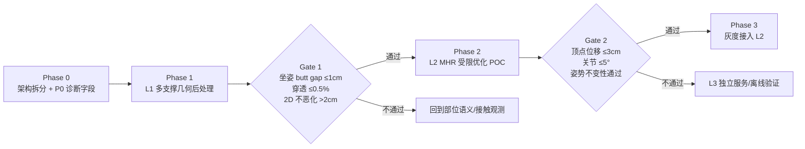

# ground_pipeline 接入接触/穿透优化：方案评估

- 日期：2026-10-22
- 性质：评估文档（不含代码改动）
- 评估对象：在 `ground_pipeline` 现有 A→E 落地链路上，接入「接触 / 穿透优化」的可行性与路线
- 参考实现：仓库根目录 PhySIC 的 `contact_loss` / `interpenetration_loss`（[optimizer.py:502-527](file:///g:/UGit/Phy-SIC/optimizer.py#L502-L527)）
- 前置结论依据：[验收失败记录_SAM3D姿势优化.md](file:///g:/UGit/Phy-SIC/ground_pipeline/验收失败记录_SAM3D姿势优化.md)、[方案_坐姿臀部未触地.md](file:///g:/UGit/Phy-SIC/ground_pipeline/方案_坐姿臀部未触地.md)

---

## 0. 结论摘要

1. **接触/穿透优化可以接入，输入数据基本齐全**：DepthPro 点云、地面平面、人物点云、SAM3D 网格/关节/2D 关键点、相机内参都在服务内可得。
2. **但"优化哪些变量"决定成败**。历史实机验证已证明：放开 137 维关节 + 尺度会把姿势改写（最大顶点位移 13.3 cm、尺度漂移 1.7%、2D 残差恶化 2 cm），因此 E 段最终收缩为 **1-DOF 法向平移**。
3. **建议分三档接入，不要一次性搬 PhySIC 全流程**：

| 档位 | 名称 | 优化变量 | 新增依赖 | 推荐度 |
|---|---|---|---|---|
| **L1** | 纯几何多支撑后处理 | 法向平移 + 支撑线小角度旋转 | 无 | ★★★★★ 先做 |
| **L2** | MHR 网格上的受限接触优化 | 全局刚体 + 骨盆链（≤5°/3cm） | 需要 MHR 前向 API | ★★★☆ 需 POC |
| **L3** | SAM3D→SMPL-X→PhySIC loss | SMPL-X body_pose + 全局 + 平移 | SMPL-X、DECO、pytorch3d 等 | ★★★ 独立/离线 |
| L4 | 直接复用 PhySIC 全流程 | 全量 HumanScene | CameraHMR、OmniEraser、MoGe… | ☆ 不采用 |

4. **无论选哪档，必须先修一个架构问题**：当前网格对齐只在 `visualize && pose_want_mesh` 分支执行（[ground_service.py:1596-1628](file:///g:/UGit/Phy-SIC/ground_pipeline/ground_service.py#L1596-L1628)），接触优化结果无法被上游/导出消费。需要拆成「计算」与「渲染」两段。
5. **如果只允许做一件事**：做 L1（多支撑 minimax + 支撑线旋转 + 穿透钳制）并输出 `contact_parts` / `support` 诊断字段。

---

## 1. 目标与约束

### 1.1 目标定义

「接触/穿透优化」在本文中指：

- **接触**：语义上应该接触地面的部位（坐姿骨盆、站姿脚、跪姿膝、手撑手掌）贴近支撑面；
- **穿透**：人体网格顶点不得低于地面（或穿入场景表面）；
- **保真**：不得改写 SAM3D 预测的姿势、体型与朝向，只允许最小必要的整体/局部调整。

### 1.2 现有硬约束

| 约束 | 来源 / 数值 |
|---|---|
| 姿势不得被改写 | [验收失败记录:42-46](file:///g:/UGit/Phy-SIC/ground_pipeline/验收失败记录_SAM3D姿势优化.md#L42-L46) |
| E 段默认 1-DOF 法向平移 | [验收失败记录:54-68](file:///g:/UGit/Phy-SIC/ground_pipeline/验收失败记录_SAM3D姿势优化.md#L54-L68) |
| 单次请求 10~30s，上游超时 ≥120s | [项目介绍:234](file:///g:/UGit/Phy-SIC/ground_pipeline/ground_pipeline%20项目介绍.md#L234) |
| 目标 12GB 显卡；与 qwen3-vl 同机约 7.8GB，余量约 4GB | [项目介绍:237](file:///g:/UGit/Phy-SIC/ground_pipeline/ground_pipeline%20项目介绍.md#L237) |
| SAM3D 为可选模块，失败必须降级且不影响地面服务 | [GROUND_SERVICE_API.md:155](file:///g:/UGit/Phy-SIC/ground_pipeline/GROUND_SERVICE_API.md#L155) |
| ground_pipeline 自身依赖仅 numpy / Pillow | [pyproject.toml:10](file:///g:/UGit/Phy-SIC/ground_pipeline/pyproject.toml#L10) |
| WSL CUDA 初始化顺序（DepthPro 先于 LangSAM）不得改动 | [升级计划:102](file:///g:/UGit/Phy-SIC/ground_pipeline/升级计划_SAM3D_Body姿势推理.md#L102) |

### 1.3 现状输入清单

| 优化所需输入 | ground_pipeline 是否已有 | 说明 |
|---|---|---|
| 场景点云 | ✅ | DepthPro 反投影 |
| 地面平面（法向 + d） | ✅ | RANSAC + PCA |
| 人物点云 | ✅ | person mask 反投影 |
| 人物 2D mask | ✅ | LangSAM |
| SAM3D 网格顶点/面 | ✅ | `mesh_vertices_model` / `mesh_faces` |
| SAM3D 3D 关节 | ✅ | MHR-127 → SMPL-24 |
| SAM3D 2D 关键点 | ✅ | MHR-70 |
| 相机内参 | ✅ | 模型估计 |
| **逐点场景法向** | ❌ | 服务内只保留平面法向，未计算逐点法向 |
| **逐顶点接触标签** | ❌ | 无 DECO / PROX 先验 |
| **逐部位接触语义** | ❌ | 接触点是无标签点集 |
| **MHR 前向 / 蒙皮 API** | ❌（待确认） | vendor 源码不在当前 checkout |
| **SMPL-X body model** | ❌ | ground 环境未安装 |
| **DECO 权重与推理** | ❌ | 仅在根目录 PhySIC 中使用 |
| **可微 MHR 参数** | ❌（待确认） | 适配层只消费顶点/关节/旋转 |

这张表决定了：**L1 现在就能做；L2 卡在 MHR API；L3 需要引入一整套新依赖。**

---

## 2. 基线能力与缺口

### 2.1 现有 A→E 分别能做什么

| 阶段 | 能力 | 不能做什么 |
|---|---|---|
| A 地面锚定 | 把网格最低点放到地面 | 不理解"哪个部位应该接触" |
| B trimmed ICP | 整体平移到人物点云 | 被遮挡的臀部无约束 |
| C2 接触面转平 | ≤5° 让接触面贴合地面 | 接触点只有四肢时，枢轴围绕四肢 |
| D 接触簇落位 | 按接触点簇做垂直吸附 | 中位数允许一半簇悬空 |
| E 刚体精修 | 1-DOF 法向平移 + 穿透检查 | 无法解决多支撑高度冲突 |

### 2.2 核心缺口

1. **无逐点法向**：无法判断顶点在场景表面的内侧还是外侧，只能按"高度 < 0"判穿透；对斜坡、台阶、非平面场景失效。
2. **无部位语义**：不知道坐姿骨盆是主支撑，求解器只能按"最低点"处理。
3. **无接触先验**：臀部被遮挡时没有任何信号告诉优化器"这里应该接触"。
4. **无受限姿态自由度**：E 段把姿态参数全部冻结，遇到"支撑冲突"只能放弃一方。
5. **计算与渲染耦合**：对齐结果只在可视化分支产生，业务侧拿不到。

### 2.3 历史教训（必须纳入评估）

137 维参数优化的实测失败数据：

| 指标 | 数值 |
|---|---|
| `delta_pose_rms` | 0.0508 rad（≈2.9°） |
| `scale_factor` | 1.0171（体型被放大 1.7%） |
| `max_vertex_shift_m` | 0.133 m |
| 2D 关键点 RMSE | 0.2642 → 0.2845 m（恶化 2 cm） |
| 结论 | 姿势被改写，方案整体废弃 |

这说明：**任何"用场景损失去调姿态参数"的方案，都必须有强图像监督与严格自由度限制**，否则一定重演。PhySIC 原版之所以能收敛，是因为它有 2D 关键点、深度、接触、穿透、正则五项联合，并且姿态初值来自 CameraHMR；ground_pipeline 目前只有稀疏点云与 70 个 2D 关键点，监督强度不对等。

---

## 3. 候选方案

### L1：纯几何多支撑后处理（无学习、无新模型）

**思路**：不碰姿势参数，只在刚体自由度里做"多支撑一致性"，必要时绕已贴地的支撑线做 ≤5° 旋转。

**变量**：

- `o`：沿地面法向的平移（必选）；
- `θ`：绕次支撑簇（脚/手）主轴的旋转（可选，≤5°）；
- 可选 `roll/pitch`：仅在 ≥3 个支撑簇且冲突 > 2cm 时启用（≤3°）。

**目标**：

```
g_i = percentile_5( { h(v) | v ∈ P_i } )          # 部位 i 的最低高度
o*  = argmin_o max_i w_i · |g_i + o|              # 加权极小极大
θ*  = atan((g_primary - g_secondary) / r)         # 绕支撑线，clamp ±5°
```

**能解决**：

- 坐姿臀部悬空（配合部位语义与推断接触）；
- 脚/手悬空；
- 地板穿透（硬下界 -1cm）。

**不能解决**：

- 非地面物体穿透、自穿插；
- SAM3D 姿势本身的错误（例如坐姿臀部在网格里就高得离谱）；
- 大幅倾斜的支撑面。

**新增依赖**：无。

**集成点**：替换/扩展 D 段与 E 段；数据全部已有。

**资源**：CPU 毫秒级；0 显存。

**风险**：支撑语义误判（需要 P4 分类）、旋转导致 2D 漂移（需要护栏）。

**回退**：保留现有 1-DOF 平移。

**评价**：**投入产出比最高**，但不能宣称"物理正确的碰撞处理"，只是"支撑一致性摆放"。

---

### L2：MHR 网格上的受限接触/穿透优化

**思路**：在 SAM3D 的 MHR 网格上直接加接触/穿透 loss，只放开"全局刚体 + 骨盆链"，不碰尺度、体型、手臂、手指。

**变量**：

- 全局：`dtrans(3)`，仅法向分量生效；`drot(3)` 可选；
- 骨盆链：左右髋、左右膝、左右踝，共 6 个关节 × 3 = 18 维；
- 硬上限：单关节 ≤5°，顶点位移 ≤3cm，整体位移 ≤15cm。

**目标**：

```
E = w_c · Σ_{v∈contact}  ρ(dist(v, S))
  + w_p · Σ_{v}  ρ(relu(-sdf(v) - 1cm))
  + w_k · ||π(J(θ)) - kp_2d||²
  + w_r · ||θ - θ0||²
```

其中 `S` 为场景点云/平面，`sdf` 用逐点法向符号，`ρ` 为鲁棒核。

**前提条件（当前阻塞项）**：

1. 需要 MHR 的**可微前向/蒙皮**接口与 pose 参数访问；
2. 当前 `ImagePose_Resources` 里没有 `vendor/sam-3d-body` 源码（本机 checkout 缺失），适配层也只暴露顶点/关节/旋转（`sam3d_adapter.py`）；
3. 需要逐点场景法向（服务内未计算）。

**能解决**：落臀 + 穿透 + 小幅姿势修正。

**不能解决**：大幅姿势错误；MHR API 不提供参数时完全不可行。

**新增依赖**：无新模型，但需要 vendor 源码与 MHR forward。

**资源（量级估计，需实测）**：+0.5~1.5GB 显存，+2~10s/人。

**风险**：

- **重演 137 维失败**：即使只开骨盆链，若几何监督不足，仍可能用关节凑接触；
- MHR 参数布局/版本不稳定；
- 自穿插未处理。

**回退**：`status=rejected`，保留 L1/E 结果。

**评价**：技术上最"贴合现有栈"，但可行性依赖 vendor API，必须先做 1~2 天量级的 POC 验证（不改主链路）。

---

### L3：SAM3D → SMPL-X 拟合 → PhySIC 接触优化

**思路**：把 SAM3D 的关节/网格作为初值，拟合 SMPL-X，再复用 PhySIC 的 contact/interpenetration + 2D/深度联合优化。

**流程**：

```
SAM3D joints/mesh → SMPL-X fitting（SMPLify-X 式）
                  → DECO 接触概率 / PROX 静态接触
                  → contact + interpenetration + 2D + depth + reg 联合优化
```

**变量**：`global_orient(3)`、`transl(3)`、`body_pose(21×3)`、手部（可冻结）、`betas`（建议冻结）。

**能解决**：效果上限最高。接触语义、穿透、2D 保真都有成熟实现。

**代价**：

- 需要 SMPL-X 权重（注册/许可）、DECO 权重、`pytorch3d`、`robust_loss_pytorch`、`smplx` 等；
- 双拟合误差：SAM3D → SMPL-X 再优化，手/脚细节可能丢失；
- 10475 顶点 + kNN 查询，延迟与显存显著增加；
- 与 ground 环境（仅 numpy/Pillow，torch 由 SAM3D 资源提供）隔离度高，安装复杂；
- WSL CUDA 顺序约束可能被新依赖打破。

**资源（量级估计，需实测）**：+2~4GB 显存，+10~40s/人；若沿用 PhySIC 的 OmniEraser 相关路径则不可接受。

**建议**：**作为独立可选服务或离线任务**，不进在线 `/v1/ground` 主链路。

**回退**：独立开关/独立 endpoint。

---

### L4：直接复用 PhySIC 全流程（不推荐）

**为什么不可行**：

1. 根目录 PhySIC 使用 CameraHMR 出初值、OmniEraser 做图像修复、MoGe/DepthPro 做深度，与 ground_pipeline 的 DepthPro/LangSAM/SAM3D 重复且冲突；
2. `INSTALL.md` 要求 ≥40GB 显存（主要来自 OmniEraser/FLUX），与 12GB 目标不兼容；
3. `HumanScene` 紧耦合图像加载、掩码、inpainting、多阶段配置，不是可插拔模块；
4. 当前 checkout 未包含 `install.sh`（`INSTALL.md` 引用了它），环境复现需另行确认；
5. 商业许可：SMPL/SMPL-X 需注册且有非商用限制，DECO 为研究许可，需法务评估。

**结论**：只复用其 **loss 设计、鲁棒核、参数常量**（`max_distance_contact=0.15`、`max_distance_interpenetration=0.15`、`AdaptiveLossFunction(3)`），不复用代码栈。

---

### 排除项

| 方案 | 排除理由 |
|---|---|
| MuJoCo / PhysX 物理求解 | 网格非水密、软体/衣物参数难标定；接触参数与延迟不可控；最多用于离线验证 |
| 用 2D keypoint prompt 迭代重推理 | 不是 IK，无法控制 3D 结果，碰撞无感知 |
| 逐顶点位移变形 | 破坏网格局部刚性，必然产生褶皱/拉伸，且无法回退 |

---

## 4. 对比矩阵

权重：支撑修复 30%、穿透修复 20%、姿势保真 20%、部署成本 15%、延迟 15%。评分 1–5，为主观预估，需 POC 后校正。

| 方案 | 支撑修复 | 穿透修复 | 姿势保真 | 部署成本 | 延迟 | 加权分 |
|---|---|---|---|---|---|---|
| **L1 几何后处理** | 4 | 3 | 5 | 5 | 5 | **4.30** |
| **L2 MHR 受限优化** | 4 | 4 | 3 | 3 | 3 | **3.50** |
| **L3 SMPL-X + PhySIC loss** | 5 | 5 | 4 | 2 | 2 | **3.90** |
| L4 PhySIC 全流程 | 5 | 5 | 2 | 1 | 1 | 3.20 |

补充说明：

- L1 的"穿透修复 3 分"指地板穿透；它无法处理与家具/物体的穿插。
- L2 的"姿势保真 3 分"来自历史风险，不代表必然失败，但必须设硬上限。
- L3 的"姿势保真 4 分"是因为有 2D/深度/先验联合监督，但双拟合仍可能损失手部细节。

---

## 5. 推荐路线与门禁



### Gate 1（L1 验收）

- 坐地：`|gap_pelvis| ≤ 1cm`，`gap_foot/hand ≤ 3cm`；
- `penetration_ratio ≤ 0.5%`；
- 2D 重投影 RMSE 相对 L1 前恶化 `≤ 2cm`；
- 边长直方图差异 `≤ 1%`（刚体不变性）。

### Gate 2（L2 准入）

- `max_vertex_shift ≤ 3cm`；
- 单关节增量 `≤ 5°`；
- `scale/betas/手臂/手指` 完全冻结；
- 2D RMSE 恶化 `≤ 2cm`；
- 连续 20 张回归图无"姿势走形"人工否决。

### Gate 3（L3 准入）

- 独立部署资源实测（显存、延迟、并发）；
- 许可与合规确认；
- 与 L1/L2 的 A/B 对比有稳定增益；
- 不满足则只保留离线研究，不进入产品链路。

---

## 6. 接入架构与接口设计

### 6.1 推荐链路位置

```
A 地面锚定 → B ICP → C2 接触面转平 → D 接触簇落位 → E 1-DOF 刚体
                                              ↓
                                   L1 多支撑几何后处理
                                              ↓
                                   （可选）L2 受限接触优化
                                              ↓
                                   输出网格 + 接触/穿透诊断
```

- L1 放在 E 之后：E 已经保证无穿透与整体贴地，L1 只解决"多支撑冲突"。
- L2 放在 L1 之后：只在 `support_conflict=true` 时触发，避免无谓优化。

### 6.2 计算与渲染拆分（必须先做）

现状：对齐只在 `visualize && pose_want_mesh` 内执行（[ground_service.py:1596-1628](file:///g:/UGit/Phy-SIC/ground_pipeline/ground_service.py#L1596-L1628)）。

建议拆成：

1. **计算段**：`pose_inference && pose_want_alignment` 时执行 A→E→L1/L2，产出 `mesh_world` 与诊断字段；
2. **渲染段**：`visualize && pose_want_mesh` 时只消费已算好的网格出图，不重复计算。

收益：业务侧可在不请求图片的情况下拿到接触优化结果；避免"开了可视化才有对齐"的隐性耦合。

### 6.3 请求/响应字段（只增不改）

请求新增：

```json
{
  "contact_refine": "off | lite | full",
  "support_pose_class": "auto | stand | sit_floor | kneel | lie | hand_support",
  "max_pose_delta_deg": 5.0,
  "max_vertex_shift_m": 0.03
}
```

响应新增：

```json
{
  "contact_parts": {
    "pelvis": {"gap_m": 0.004, "source": "inferred", "visible_ratio": 0.12},
    "l_foot": {"gap_m": 0.001, "source": "observed", "visible_ratio": 0.91}
  },
  "support": {
    "pose_class": "sit_floor",
    "mandatory": ["pelvis", "l_foot", "r_foot"],
    "offset_m": -0.004,
    "rotation_deg": 0.0,
    "conflict_m": 0.003,
    "conflict": false
  },
  "contact_refine": {
    "mode": "lite",
    "status": "applied | rejected | skipped",
    "losses": {...},
    "max_vertex_shift_m": 0.006,
    "reject_reason": null
  }
}
```

约束：

- `contact_refine=off` 时行为与现状完全一致；
- 任何异常 → `status=rejected` + 保留 E 结果，不影响 `ok`；
- `contact_pixels` / `contact_centroid_m` 保持"纯观测"语义，不被推断接触污染。

### 6.4 并发与缓存

- 接触优化是 CPU/GPU 混合；若在 GPU 上跑，需与 SAM3D 串行，避免显存峰值叠加；
- 以 `image_hash + 参数摘要` 做结果缓存，离线批处理可复用；
- 批处理（instance_test）可默认 `lite`，在线服务默认 `off`，灰度后再开。

---

## 7. 资源与依赖评估

| 项目 | L1 | L2 | L3 |
|---|---|---|---|
| 新增 Python 依赖 | 无 | 无（复用 SAM3D/torch） | `smplx`、`pytorch3d`、`robust_loss_pytorch`、DECO 相关 |
| 新增模型权重 | 无 | 无 | SMPL-X、DECO |
| 显存增量 | 0 | 0.5~1.5GB（估） | 2~4GB（估） |
| 单次延迟增量 | < 0.1s | 2~10s（估） | 10~40s（估） |
| 安装复杂度 | 无 | 低 | 高（CUDA/编译依赖） |
| 与 WSL CUDA 顺序冲突 | 无 | 低 | 中高 |
| 许可风险 | 无 | 取决于 MHR/SAM3D | SMPL-X 非商用、DECO 研究许可 |
| 可回退性 | 高 | 中 | 低（独立服务则高） |

说明：

- 显存/延迟为**量级估计**，必须在目标 12GB 机器上实测后写回文档，不能作为承诺值；
- 根目录 PhySIC 的 40GB 要求主要来自 OmniEraser/FLUX，不代表 L3 一定需要 40GB；但 L3 的 kNN + 10475 顶点优化仍需实测；
- `INSTALL.md` 引用的 `install.sh` 在当前 checkout 中不存在，L3 环境复现需先补齐。

---

## 8. 验收与回归

### 8.1 指标

| 指标 | 定义 | 目标 |
|---|---|---|
| `gap_pelvis` | 骨盆区域顶点高度 5% 分位 | 坐地 `|·| ≤ 1cm` |
| `gap_foot/hand` | 对应部位 5% 分位 | `≤ 3cm` |
| `support_conflict_m` | 必选支撑间高度差的一半 | `≤ 1cm` |
| `penetration_ratio` | 高度 < -1cm 顶点占比 | `≤ 0.5%` |
| `max_vertex_shift_m` | 相对输入网格的最大顶点位移 | L1 `≤ 1cm`；L2 `≤ 3cm` |
| `reproj_rmse_m` | 2D 关键点重投影误差 | 恶化 `≤ 2cm` |
| `pose_invariance` | 边长直方图差异 | `≤ 1%` |
| `silhouette_iou` | 渲染轮廓与 person mask 的 IoU | 下降 `≤ 3%` |

### 8.2 回归集

| 图 | 姿势 | 期望 |
|---|---|---|
| `yoga_core.jpg` | 坐地/盘腿 | 臀部贴地，脚不悬空 |
| `5306...qco6j...jpg` | 仰卧抬腿 | 双脚在空中是正确结果，不得强压 |
| `5306...sz459j...jpg` | 跪趴 | 膝/手支撑，臀部不压地 |
| 站立人像 | 站立 | 与现状完全一致 |
| 坐沙发/台阶 | 坐物体 | 不压到地面（需支撑面检测） |

### 8.3 评估方法

- 离线批量跑回归集，输出上表指标 + 三视图；
- A/B：现状 vs L1 vs L2，人工盲评"姿势是否被改写"；
- 每次改动必须给出"指标 + 图"两份证据，避免只看接触高度。

---

## 9. 风险清单与缓解

| 风险 | 影响 | 缓解 |
|---|---|---|
| 姿势被改写（历史重演） | 高 | 冻结姿态参数（L1）；L2 只开骨盆链 + 硬上限 + 2D 护栏 + `rejected` 回退 |
| 支撑语义误判 | 中高 | 姿势分类置信度阈值；低置信度退回最低点逻辑 |
| 坐下物体被误压 | 中 | P6 支撑面检测；检测到髋部水平面即跳过 |
| 接触观测缺失 | 中 | 推断接触弱约束；`source` 字段区分观测/推断 |
| 旋转导致 2D 漂移 | 中 | ≤5°、绕支撑线、RMSE/IoU 护栏、按比例混合 |
| MHR API 不可用 | 高（L2） | 先 POC；不可用则只做 L1 |
| 依赖冲突/显存不足 | 高（L3） | 独立服务/离线；资源实测；失败隔离 |
| 许可合规 | 中高（L3） | 法务评估 SMPL-X/DECO；必要时只用 L1 |
| 维护成本 | 中 | 只保留一条主链路，L2/L3 用开关隔离，不并行维护多套 |

---

## 10. 决策建议

1. **短期（推荐立即执行）**：
   - 拆分"计算/渲染"；
   - 增加 `contact_parts` / `support` 诊断；
   - 实现 L1：多支撑 minimax + 支撑线旋转 + 穿透钳制。
   - 这能直接解决"四肢触地、臀部悬空"的大部分案例，且不引入任何新依赖。

2. **中期（条件触发）**：
   - 做 L2 POC，先验证 MHR 前向/蒙皮与参数访问是否可用；
   - 只在 `support_conflict=true` 且 L1 无解时启用；
   - 严格冻结尺度、体型、手臂、手指。

3. **长期（独立能力）**：
   - 如果业务要求"真正的场景接触/穿透物理正确性"，走 L3，但作为**独立可选服务/离线任务**；
   - 不在 `/v1/ground` 主链路内引入 SMPL-X + DECO + pytorch3d；
   - 以 A/B 数据和许可结论决定是否产品化。

4. **明确不做**：
   - 不把根目录 PhySIC 全流程搬进 ground_pipeline；
   - 不用物理引擎做在线求解；
   - 不用 2D keypoint prompt 迭代冒充 IK。

**一句话结论**：L1 是当前性价比最高、风险最低的接入方式；L2 是"能碰到真问题但需验证"的中间态；L3 是效果上限最高但应隔离部署的重方案。先修架构与诊断，再谈优化器。
